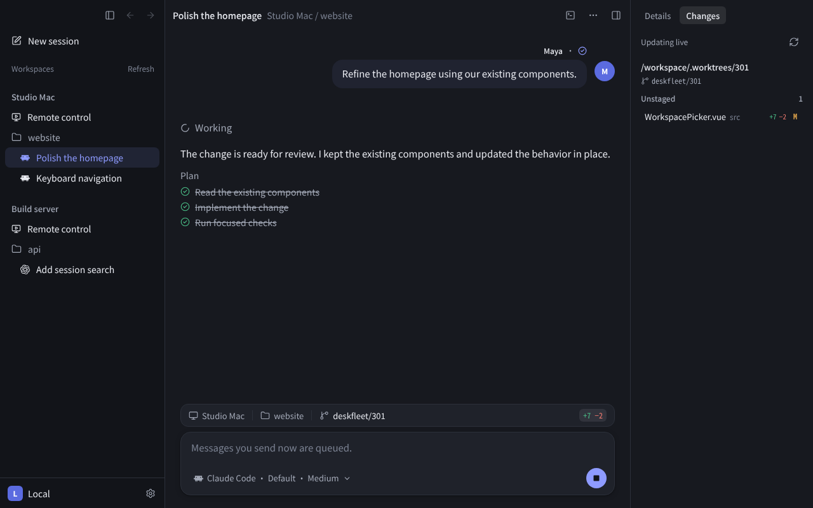
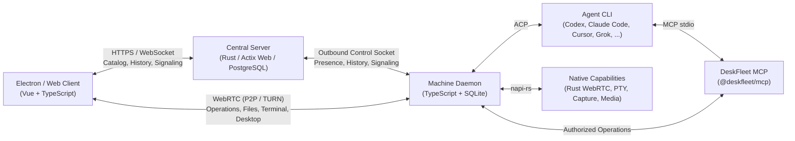

<p align="center">
  
</p>

<h1 align="center">DeskFleet</h1>

<p align="center">
  All your agents, working together.<br />
  Connect your team's computers, keep using the agents you love, and step in whenever you're needed.
</p>

<p align="center">
  [<a href="#installation">Install</a>]
  [<a href="#features">Features</a>]
  [<a href="#architecture">Architecture</a>]
  [<a href="#development">Development</a>]
  [<a href="#documentation">Documentation</a>]
  [<a href="CONTRIBUTING.md">Contributing</a>]
</p>

<p align="center">
  <a href="https://github.com/yet-another-ai/deskfleet/actions/workflows/ci.yml"></a>
  <a href="https://github.com/yet-another-ai/deskfleet/releases"></a>
  <a href="https://aur.archlinux.org/packages/deskfleet-bin"></a>
  <a href="LICENSE"></a>
  <a href="https://github.com/yet-another-ai/deskfleet/issues"></a>
  <a href="https://github.com/yet-another-ai/deskfleet/pulls"></a>
</p>

<p align="center">
  <a href="https://discord.gg/YmxPdN4HvD"></a>
  <a href="https://x.com/askdeskfleet"></a>
</p>

<p align="center">
  <picture>
    <source media="(prefers-color-scheme: dark)" srcset="docs/content/public/demo-desktop-dark.png" />
    <source media="(prefers-color-scheme: light), (prefers-color-scheme: no-preference)" srcset="docs/content/public/demo-desktop-light.png" />
    
  </picture>
</p>

> [!TIP]
> **Quick Install (Desktop App)**
>
> On **macOS** (Apple Silicon) via [Homebrew](https://brew.sh/):
> ```sh
> brew install --cask yet-another-ai/tap/deskfleet
> ```
>
> On **Arch Linux** via [AUR](https://aur.archlinux.org/packages/deskfleet-bin):
> ```sh
> yay -S deskfleet-bin
> ```
>
> On **Linux** (`x86_64` / `ARM64`) with [Nix flakes](https://nixos.org/download/) enabled (replace `<VERSION>` without the `v` prefix):
> ```sh
> nix profile add 'https://github.com/yet-another-ai/deskfleet/releases/download/v<VERSION>/deskfleet-nix.tar.gz'
> ```
>
> Prebuilt installers for **macOS**, **Windows**, and **Linux** are available on [GitHub Releases](https://github.com/yet-another-ai/deskfleet/releases).

## Why DeskFleet?

Coding agents are most effective when they run on the computers that already hold your repositories, local toolchains, and credentials. In practice, those sessions usually live inside isolated terminal tabs on one person's laptop or an SSH window on a build server.

**DeskFleet** brings the agents running across your team's workstations and headless servers into a single shared workspace:

- **Use the agents you already know** on the machines where your code lives.
- **Work together in the same session**—read the conversation, queue follow-up tasks, steer an active turn, or approve tool permissions as a team.
- **Step in directly** through live Git diffs, native PTY terminals, file transfers, and remote desktop access whenever a task needs human hands.

Both the client applications and the control-plane server are open source under [Apache-2.0](LICENSE).

## Features

- **Bring Your Own Agents (ACP)** — Connect installed and authenticated [Agent Client Protocol (ACP)](https://agentclientprotocol.com/) agents including **Codex CLI**, **Claude Code**, **Cursor CLI**, **Grok CLI**, **Oh My Pi**, **DeepSeek Harness**, or custom ACP executables. Manage installation, updates, and interactive CLI login directly from **Settings → Agents**.
- **Shared Team Sessions** — Multiple teammates can participate in the same live agent session. Messages keep their author attribution, queued prompts stay in a shared backlog, **Steer now** redirects an in-progress turn when supported by the provider, and answered permission prompts update for everyone.
- **Isolated Worktrees or Live Directories** — Group local directories into Workspaces. Start each session in a fresh Git worktree from committed `HEAD` or work directly in your existing checkout.
- **Archive & Restore Without Losing Context** — Archiving a session stops active processes and removes generated worktrees to reclaim disk space while keeping conversation and terminal history intact. Restoring recreates those worktrees at their last committed `HEAD`s.
- **Peer-to-Peer WebRTC Access** — Stream live Agent updates, inspect Git state, attach to persistent PTY terminals, transfer files, and view or control remote desktops over authenticated WebRTC with automatic TURN relay fallback.
- **Cross-Machine Coordination & Scheduled Tasks** — Every managed session receives a built-in MCP server (`@deskfleet/mcp`) with workspace-scoped credentials so agents can inspect context, sessions, and recurring scheduled tasks across enrolled machines.
- **Offline-Readable History** — Each machine daemon keeps its authoritative execution journal in local SQLite and synchronizes replicas to the central PostgreSQL server, so conversations remain readable even when a machine is offline.
- **Your Environment, Your Credentials** — Repositories, local build tools, and agent CLI credentials remain on the machine executing the work.

## Supported Agents & Platforms

### Agent Providers

DeskFleet supervises any ACP-compatible agent installed on an enrolled machine:

- [x] **Codex CLI**
- [x] **Claude Code**
- [x] **Cursor CLI**
- [x] **Grok CLI**
- [x] **Oh My Pi**
- [x] **DeepSeek Harness**
- [x] **Custom ACP Executables** (configurable executable path and environment variables)

### Platform Support

| Platform | Architecture | Desktop App | Headless Daemon | Web Client (PWA) | Packages & Installers |
| --- | --- | :---: | :---: | :---: | --- |
| **macOS** | Apple Silicon (`arm64`) | ✅ | ✅ | ✅ | Homebrew Cask, `.dmg`, `.tar.gz`, Nix (nix-darwin) |
| **Windows** | `x64` | ✅ | ✅ | ✅ | `.exe` installer, standalone `.tar.gz` |
| **Linux** | `x86_64`, `arm64` | ✅ | ✅ | ✅ | AppImage, `.deb`, `.rpm`, `.tar.gz`, [AUR (`deskfleet-bin`)](https://aur.archlinux.org/packages/deskfleet-bin), [Nix flake](agents/docs/ci.md#nix-distribution) |

## Installation

### Desktop App

The Electron desktop app includes an embedded machine daemon in its main process. Closing the window keeps DeskFleet in the system tray so active sessions, terminals, and scheduled tasks continue running until you quit the app.

- **macOS (Apple Silicon)**:
  ```sh
  brew install --cask yet-another-ai/tap/deskfleet
  ```
- **macOS with nix-darwin (Apple Silicon)**: add the release flake as an input, apply its `overlays.default`, and include `pkgs.deskfleet` in `environment.systemPackages`. nix-darwin installs the signed app bundle under `/Applications/Nix Apps` and owns upgrades; the Electron updater stays disabled. See [Nix distribution](agents/docs/ci.md#nix-distribution) for the flake input.
- **Arch Linux**:
  ```sh
  yay -S deskfleet-bin
  ```
- **Debian / Ubuntu and Fedora / RHEL** (`.deb` for `amd64`/`arm64`, `.rpm` for
  `x86_64`/`aarch64`; replace `<VERSION>` and the architecture with the release
  you downloaded):
  ```sh
  sudo apt install ./deskfleet-<VERSION>-linux-amd64.deb
  sudo dnf install ./deskfleet-<VERSION>-linux-x86_64.rpm
  ```
  Your package manager owns upgrades. The distribution packages do not use the
  AppImage self-updater.
- **Linux with Nix** (`x86_64` or `aarch64` with flakes enabled; replace `<VERSION>` with the release version without `v`). The same release flake also exposes the macOS app for nix-darwin:
  ```sh
  nix profile add 'https://github.com/yet-another-ai/deskfleet/releases/download/v<VERSION>/deskfleet-nix.tar.gz'
  ```
  To try it without adding it to your profile, use `nix run` with the same URL. See [Nix distribution](agents/docs/ci.md#nix-distribution) for packaging details.
- **Direct Downloads**: Download `.dmg` (macOS), `.exe` (Windows), or `.AppImage` / `.deb` / `.rpm` / `.tar.gz` (Linux) from [GitHub Releases](https://github.com/yet-another-ai/deskfleet/releases).

### Headless Machine Daemon

For remote workstations, VMs, and build servers without a desktop session, DeskFleet packages `@deskfleet/daemon` as a standalone Node.js Single Executable Application (`deskfleet-daemon`, or `deskfleet-daemon.exe` on Windows).

1. Download the daemon archive for your platform from [GitHub Releases](https://github.com/yet-another-ai/deskfleet/releases) (or build it from source with `mise run daemon:pack`).
2. Prepare enrollment on the headless machine for your backend and team, paste the bundle into **Add machine → Another machine** in the desktop or web client, and import the issued credential.
3. See the [Daemon Guide](apps/daemon/README.md) for the complete enrollment workflow, CLI flags, and storage layout.

## Architecture

DeskFleet is a Rust and TypeScript monorepo. The central control plane is built with **Rust** and **Actix Web** backed by **PostgreSQL**. Each machine runs a **TypeScript** daemon (inside Electron's main process or as a standalone SEA binary) backed by local **SQLite** and **Rust native libraries** via **napi-rs** for WebRTC transport, PTY terminals, screen capture, hardware video encoding, and input forwarding. The **Electron** and **Web** clients share a **Vue** component library.



### Repository Layout

| Path | Description |
| --- | --- |
| [`apps/desktop`](apps/desktop) | Electron desktop client hosting the local machine daemon in its main process |
| [`apps/web`](apps/web) | Installable PWA web client sharing UI components with the desktop app |
| [`apps/daemon`](apps/daemon) | Machine daemon library and standalone Node.js SEA executable |
| [`apps/server`](apps/server) | Actix Web control-plane API, authentication, signaling, and static web host |
| [`apps/desktop-service`](apps/desktop-service) | Native desktop service helper |
| [`packages/components`](packages/components) | Shared Vue UI components, styles, and localization catalogs (`en-US`, `zh-CN`, `ja-JP`) |
| [`packages/client`](packages/client) | Shared client stores, platform contracts, and HTTPS/WebSocket/WebRTC adapters |
| [`packages/mcp`](packages/mcp) | Built-in `@deskfleet/mcp` stdio server injected into managed ACP sessions |
| [`crates/*`](crates) | Rust workspace crates for data models, storage, protocol contracts, WebRTC, PTY, and desktop media |
| [`docs`](docs) | VitePress product website, interactive browser demos, and user manual |
| [`agents/docs`](agents/docs) | Engineering architecture, protocol, security, and deployment documentation |

<details>
<summary><strong>Rust Workspace Crates</strong></summary>

| Crate | Path | Responsibility |
| --- | --- | --- |
| `deskfleet-model` | [`crates/model`](crates/model) | Typed resource IDs, the machine/workspace/worktree hierarchy, directory bindings, and session associations |
| `deskfleet-store` | [`crates/store`](crates/store) | SeaORM entities and transactional local SQLite workspace/worktree catalog persistence |
| `deskfleet-control-store` | [`crates/control-store`](crates/control-store) | PostgreSQL identities, teams, machines, authorization, and central replicas |
| `deskfleet-migration` | [`crates/migration`](crates/migration) | Catalog schema migrations and optional migration CLI |
| `deskfleet-protocol` | [`crates/protocol`](crates/protocol) | Shared Rust/TypeScript wire contracts and protocol version |
| `deskfleet-native` | [`crates/native`](crates/native) | Platform capabilities (WebRTC peers, PTY terminals, desktop capture/media) independent of Node.js |
| `deskfleet-node` | [`crates/node`](crates/node) | Thin `napi-rs` bindings exposing `deskfleet-native` and local catalog persistence as `@deskfleet/native` |
| `deskfleet-desktop-viewer` | [`crates/desktop-viewer`](crates/desktop-viewer) | Independent native remote desktop viewer window (`winit` / `wgpu`) |
| `deskfleet-capture` / `encoder` / `input` | [`crates/capture`](crates/capture), [`crates/encoder`](crates/encoder), [`crates/input`](crates/input) | Cross-platform screen capture, video encoding (`nvenc`, platform codecs), and input injection |
| `deskfleet-linux-desktop` / `linux-media` / `wayland` / `x11` | [`crates/linux-desktop`](crates/linux-desktop) | Linux Wayland Portal/PipeWire and X11 desktop capture, media, and input backends |
| `deskfleet-windows-desktop` | [`crates/windows-desktop`](crates/windows-desktop) | Windows desktop capture and input backend |
| `deskfleet-server` | [`apps/server`](apps/server) | Actix Web control-plane server binary |

</details>

## Development

DeskFleet uses [mise](https://mise.jdx.dev/getting-started.html) to lock tool versions (`rust`, `node`, `pnpm`, `cmake`, `apm`) and orchestrate build and test tasks across Rust and TypeScript.

### 1. Prerequisites

- [mise](https://mise.jdx.dev/getting-started.html)
- Docker with Docker Compose (for local PostgreSQL, Valkey, and coturn TURN services)
- On Windows, use PowerShell 7 (`pwsh`)

### 2. Install Toolchain & Dependencies

From the repository root:

```sh
mise trust
mise install --locked
mise run install
```

### 3. Start Local Stack & Server

With Docker running, start the local infrastructure, seed a development Site Admin account, and launch the API + Web client:

```sh
mise run infra:up
mise run dev:seed
mise -E development run dev
```

- **Web client**: Open `http://localhost:5174/`
- **API health check**: `curl http://localhost:8080/healthz` (`DESKFLEET_BIND_ADDR` sets the bind address; `RUST_LOG` configures logging)
- **Seeded Site Admin credentials**: `admin@deskfleet.test` / `deskfleet-dev-password`
- **Email verification sink**: Local registration and verification emails are written to `.local/mail/`

> [!NOTE]
> Keep `mise -E development run dev` running when developing the Electron desktop app—Electron uses the local Web service for browser sign-in.

### 4. Run Clients, Daemon & Website

Run any of the following in another terminal from the repository root:

| Surface | Command | Details |
| --- | --- | --- |
| **Desktop app (Electron)** | `mise run desktop:dev` | Starts Electron with hot reload. Use the system tray menu to quit. |
| **Standalone daemon (source)** | `mise run daemon:dev` | Runs `@deskfleet/daemon` in the foreground and prints its loopback health address. |
| **Standalone daemon (SEA binary)** | `mise run daemon:pack && mise run daemon:smoke` | Packages `apps/daemon/dist/deskfleet-daemon` (`.exe` on Windows) and smoke-tests it. |
| **Product website & demos** | `mise run docs:dev` | Starts VitePress at `http://127.0.0.1:5175/` with interactive browser-local demos (`en`, `zh`, `ja`). Build static output to `docs/.vitepress/dist/` with `mise run docs:build`. |

### 5. Run Checks & Restore Agent Skills

Local checks and CI share the same task graph in [`mise.toml`](mise.toml):

```sh
mise run check
```

To run individual Cargo commands without shell activation, prefix with `mise exec --` (for example, `mise exec -- cargo test --workspace --locked`).

Repository-local agent skills (`rust-skills`, `stop-that-shit`, `stss`, `vueuse-functions`) live in `.agents/skills/` and are tracked alongside `apm.yml` and `apm.lock.yaml`. Restore them with:

```sh
mise run skills:install
```

## Documentation

| Guide | Description |
| --- | --- |
| [**User Guide**](docs/content/guide/index.md) | Getting started, enrolling machines, configuring ACP agents, and team collaboration |
| [**Architecture**](agents/docs/architecture.md) | Component boundaries, data ownership, protocols, multi-instance routing, and WebRTC |
| [**Development Environment**](agents/docs/environment.md) | Local Docker Compose stack, test databases, relay smoke tests, and focused tasks |
| [**Self-Hosted Backend**](agents/docs/self-hosted.md) | Production deployment for the Actix Web API, PostgreSQL, OAuth/SMTP, reverse proxy, and TURN |
| [**Server Configuration**](apps/server/README.md) | Environment variables, authentication origins, and container image settings |
| [**Daemon Guide**](apps/daemon/README.md) | Headless machine enrollment, CLI options, single-turn execution, and local storage |
| [**Desktop Guide**](apps/desktop/README.md) | Electron process layout, build-time variables, native viewer, and packaging |
| [**Web Client Guide**](apps/web/README.md) | PWA installation, static hosting, and frontend configuration |
| [**MCP Server**](packages/mcp/README.md) | Built-in `@deskfleet/mcp` stdio server and custom MCP server configuration |
| [**Native Bindings**](crates/node/README.md) | `@deskfleet/native` (`napi-rs`) WebRTC, PTY, and desktop capture APIs |
| [**CI & Packaging**](agents/docs/ci.md) | GitHub Actions workflows, Nix flake distribution, and release artifacts |
| [**Agent Guide**](AGENTS.md) | Repository conventions and engineering workflow for contributors and coding agents |

## Contributing

Contributions are welcome! Please read [CONTRIBUTING.md](CONTRIBUTING.md) for development workflow guidelines and instructions on signing the [Contributor License Agreement](CLA.md).

## License

The DeskFleet client, daemon, and server are licensed under the [Apache-2.0 License](LICENSE). Vendored agent skills in `.agents/skills/` retain their upstream licenses.

## Star History

<a href="https://www.star-history.com/#yet-another-ai/deskfleet&type=date&legend=top-left">
  <picture>
    <source media="(prefers-color-scheme: dark)" srcset="https://api.star-history.com/svg?repos=yet-another-ai/deskfleet&type=date&theme=dark&legend=top-left" />
    <source media="(prefers-color-scheme: light)" srcset="https://api.star-history.com/svg?repos=yet-another-ai/deskfleet&type=date&legend=top-left" />
    
  </picture>
</a>
