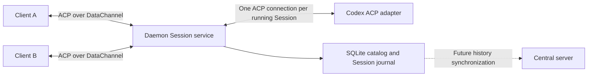

# Agent Session persistence and ACP transport

The daemon owns persistent Codex Sessions, their provider processes, and their
conversation journal. Electron uses the same ACP DataChannel facade intended for
remote clients. This document owns the collaboration, persistence, and transport
contract; [architecture](architecture.md) owns the resource hierarchy.

## Ownership and collaboration

All authorized clients can operate on a Session simultaneously, without a control
lease. The daemon orders state
changes, input delivery, and permission decisions. Client connections, provider
processes, and durable Sessions have separate lifetimes: closing every viewer
leaves the Agent running and its approvals pending.

A managed Session belongs to one Workspace and records an immutable `context`.
A `worktree` Session owns generated checkouts; a `directory` Session uses the
Workspace's own directories in place. Its captured ordered directories are the
execution context; the first supplies `cwd`. Later Workspace edits do not
retarget existing Sessions. Session creation also retains a failed provisioning
record when Git setup fails or a directory is missing. Stopping a provider
preserves the Session and its files. Explicit deletion removes a worktree
Session's disposable checkouts before deleting the catalog resource; a directory
Session's files are never removed. The new-session composer offers both contexts
and remembers the last choice on that device.

## Identity and audit

Database resource IDs remain signed 64-bit integers, encoded as decimal strings
on the wire. A persistent catalog origin UUID qualifies remote references as
`{ originId, id }`. A new database gets a new origin. Session IDs, opaque provider
conversation IDs, and connection-local JSON-RPC request IDs are distinct.

Every mutation has a client-generated UUID `operationId` and a daemon-assigned
command ID. Its actor comes from the authenticated connection, never request
parameters or `_meta`. The actor contains `kind`, optional `userId`, a qualified
`sourceMachine`, and optional `deviceId`. Input authors and the people selecting
those inputs for steering are recorded separately. Default backlog dispatch is
a system action. The target machine is the daemon's catalog identity.

Current signaling authenticates a local discovery token and records
`kind: local_token` with the local source machine. Remote enrollment must bind
peers to verified users and source devices before authorizing Session access.

Canonical operation IDs are unique within the catalog. Repeating the same actor,
method, target, and parameters returns the saved receipt/result. Reusing an ID
with different parameters or identity appends a rejected noncanonical command
linked to the original. It never replaces the original audit. JSON-RPC IDs can
coincide between clients without referring to the same operation.

Commands retain actor, target, parameters, received/completed timestamps, status,
result, and error. Deleting a Session clears live foreign keys while retaining
immutable target IDs and audit JSON, including the delete receipt. A retry of an
interrupted delete resumes cleanup, or completes its receipt if the target was
already removed. Failed operations require a new operation ID to attempt again.

## Persistence model

The existing SQLite catalog is the only Agent database. `deskfleet-store` owns
SeaORM transactions, `deskfleet-model` owns typed records, and `deskfleet-node`
exposes thin JSON bindings. The daemon owns scheduling, Git orchestration, and
ACP callbacks. Records preserve ACP payloads as JSON; indexed columns enforce
ownership, lookup, and active-resource constraints.

| Table | Key | Responsibility |
| --- | --- | --- |
| `catalog_identity` | Singleton | Persistent catalog origin UUID |
| `agent_id_allocator` | Singleton | Durable IDs for commands, inputs, turns, and permissions |
| `workspace_sessions` | Existing `id` | Canonical Workspace ownership |
| `agent_sessions` | `session_id` | Provider identity, title, lifecycle, capabilities, journal watermark, timestamps/error |
| `agent_runs` | `(session_id, generation)` | Provider process state and start/end timestamps/error |
| `agent_commands` | `id`; canonical `operation_id` | Immutable request audit and mutable receipt/outcome |
| `agent_inputs` | `id` | Content/author, submission command, acceptance sequence, requested and actual delivery, dispatch command/actor |
| `agent_turns` | `id` | Initial input/dispatch command, run generation, execution state, stop reason |
| `agent_permissions` | `id` | Original ACP request/options, run/turn, winning decision command/actor |
| `agent_events` | `(session_id, seq)` | Ordered domain transitions and original ACP notifications |

Session lifecycle is `provisioning`, `ready`, `provision_failed`, or `deleting`.
Runs are `starting`, `running`, `stopping`, `stopped`, `interrupted`, or `failed`.
Each new provider process gets a new generation, including when resuming a saved
conversation. Busy/idle/awaiting-approval are derived from turns and permissions.
Process handles and connected viewers stay in memory.

Inputs are `pending`, `dispatching`, `delivered`, `failed`, `withdrawn`, or
`uncertain`. Requested delivery (`backlog` or `steer`) and requested target turn
remain distinct from actual delivery (`turn_start` or `steer`) and actual turn.
One turn starts with one input and may receive several steering inputs. A
candidate does not allocate a turn until dispatch. An explicitly retried failed
input can acquire another turn; its earlier attempts remain in commands/events.

Turns are `starting`, `running`, `cancelling`, `completed`, `cancelled`,
`interrupted`, or `failed`. Permissions are `pending`, `resolved`, or `cancelled`.
Selecting a reject option is a resolved decision; cancellation means the request
is no longer live.

### Transaction boundaries

- Native constraints allow only one live run and one live turn per Session.
  Inputs, turns, permissions, and event references must belong to that Session.
- State changes and their events commit together with a compare-and-set journal
  watermark. Event sequences increase within the transaction. Publish only
  committed events; use one Session queue for domain commits and ACP callbacks.
- Atomically claim an input before any provider call. A withdraw, backlog dispatch,
  and steer cannot each consume the same candidate. Delivery callbacks must match
  the recorded dispatch command before changing the input.
- Permission resolution checks the pending state inside the same transaction as
  the decision audit and event. Invoke the upstream callback only after commit.
- Never hold a database transaction while waiting for Git, a provider, a prompt
  response, or a human decision.

Creation atomically allocates the catalog Session, provisioning metadata, and
command binding before filesystem work. Interrupted create retries return a full
Session snapshot rather than allocating another Session. Deletion marks the
Session `deleting`, stops admission, closes the provider and pending permissions,
removes any owned checkouts, and removes Session records. Incomplete cleanup retains
the deleting resource for an explicit retry. Source checkouts are untouched.

The composer accepts text. Provider content, plans, tool patches, and unknown
metadata remain in the journal. Attachments are not yet implemented. Credentials
stay on the executing machine and are not stored in audit records.

## Backlog, steering, and cancellation

Ordinary messages enter a shared backlog ordered by acceptance sequence. An idle,
running Session takes its oldest pending input. During work, the composer offers
**Add to backlog** and **Steer now**. Each pending candidate can be steered or
withdrawn by any authorized client. A confirmed failed candidate offers an
explicit retry. Failed and uncertain inputs never auto-retry.

Submission returns a durable receipt with `operationId`, command ID, input ID,
and Session ID. This receipt is distinct from the provider's `session/prompt`
response, which arrives only when the turn finishes. The facade does not expose
`session/prompt` to the composer; it uses the input extensions to preserve queue
and steering semantics.

A selected candidate keeps its original content and author. Steering records the
selecting actor and observed turn, claims the input, and reserves dispatch while
the provider answers. Competing delivery attempts fail and leave the unconsumed
input available for explicit retry.

### Codex steering boundary

The pinned `@agentclientprotocol/codex-acp` 2.2.2 package has a repository patch
for strict steering. It advertises both `_meta.steering.supported` and
`_meta.steering.supportsPromptRequired`. The request is `_session/steering` with
`_meta.steering.idleBehavior: "promptRequired"`; deskfleet also includes its
delivery command ID under `_meta.deskfleet`.

The adapter returns `injected` if it accepted the input into the active turn.
If the turn ended before injection, it returns `promptRequired` without starting
an internal prompt. The daemon then waits for the old prompt's completion and
starts a normal, tracked `session/prompt` with the steering input. This preserves
stream attribution and the final prompt outcome, including inline commands and
adapter follow-up work. Backlog dispatch stays reserved across that boundary.
An already-replaced observed turn is a stale target and is not steered.

The upstream fallback's `startedNewTurn` acknowledgement hides the final prompt
response, so it is not used. Generic failures or lost steering responses do not
prove non-delivery: mark them `uncertain`. Advertise steering only when the
strict capability is negotiated. The patch and active/idle/turn-ending cases are
covered by provider tests against the installed adapter implementation.

The timeline shows normal prompts as **In progress** until completion and steering
inputs as **Sending** until acknowledged. Unknown outcomes stay visible for
inspection and are not automatically retried.

Cancellation names a specific `turnId`. An active target becomes `cancelling`;
provider completion supplies its final state. A completed target is an audited
no-op. Recheck the active turn after asynchronous work so a late cancellation
cannot cancel the next turn or its approvals. Withdrawal affects only the named
input. Stopping a provider retains pending backlog until the next request.

A new or retried message to a stopped, interrupted, or failed agent resumes it;
successful startup then drains the backlog in acceptance order. The UI shows no
stopped or resume state. A provider that cannot resume its saved conversation
rejects the message instead of queueing it, and the UI explains that a new
Session is needed. A startup failure is recorded on the run and Session, keeps
the message queued, and is retried by the next request.

## Shared permissions

Persist each request with a stable permission ID before showing it. All attached
clients see the same options. The first valid decision wins; later decisions
return that outcome and retain their own command audit. Only the winning commit
invokes the live provider callback.

Each viewer also receives standard `session/request_permission` with a
connection-local RPC ID and the durable permission ID in `_meta.deskfleet`.
The UI records a button click through `_deskfleet/permission/respond`; a mirrored
resolution merely closes its outstanding fan-out with `cancelled`, so spectators
are not recorded as making a decision. Standard selected responses are also
supported and yield `_deskfleet/permission/receipt` notifications.

The service broadcasts resolution and the deciding actor. `$/cancel_request`
closes obsolete fan-outs. Disconnects and RPC errors leave the shared request
pending until an approver responds, the turn ends, or the provider cancels it.

## ACP over DataChannel

Each client initializes an independent JSON-RPC connection over one reliable,
ordered `deskfleet-acp` DataChannel, multiplexing its Session subscriptions.
The daemon terminates that connection and owns the separate ACP SDK connection
to each provider. RPC IDs are never forwarded between viewers and providers.
`PROTOCOL_VERSION` remains `1` while contracts are provisional.

The wire format is UTF-8 NDJSON in binary chunks, at most 16 KiB per chunk (or the
browser's negotiated SCTP limit when lower). Chunks are not JSON boundaries.
Readers reconstruct split JSON and Unicode; writers finish a message before
starting another. A reconstructed message has a 32 MiB limit, advertised at
initialization. Viewer queues and outstanding requests are bounded. Native
backpressure is retried within a bounded send deadline; a stalled viewer detaches
without blocking the provider or other clients. Reconnection reads SQLite again.

The receive loop dispatches requests concurrently instead of waiting for one
request to finish before accepting approvals and cancellation. Authentication is
bound at signaling; the DataChannel label itself is not authorization. Local
Electron IPC supplies discovery and SDP/ICE signaling only, not a separate
conversation API. Remote authenticated signaling can reuse this facade.

| Operation | Contract |
| --- | --- |
| `initialize` | Negotiate protocol, facade capabilities, byte limit, and catalog identity |
| `_deskfleet/session/list` | Read persisted Session summaries |
| `_deskfleet/session/create` | Idempotently create a worktree or directory Session and start Codex; return snapshot |
| `_deskfleet/session/subscribe` | Attach and return snapshot with `session.lastEventSeq` watermark |
| `_deskfleet/session/history` | Page events after a sequence; up to 200 events per request |
| `_deskfleet/git/status` | Inspect the Session's captured checkouts, branch/HEAD, and staged/unstaged/untracked files |
| `_deskfleet/git/diff` | Read one changed file's patch by Session, repository, relative path, and change kind |
| `_deskfleet/input/submit` | Persist text with operation ID and backlog/steer intent |
| `_deskfleet/input/steer` | Claim a candidate and steer toward the observed turn |
| `_deskfleet/input/retry` | Make a confirmed failed input pending again |
| `_deskfleet/input/withdraw` | Withdraw a pending or confirmed failed input |
| `_deskfleet/turn/cancel` | Cancel only the named execution turn |
| `_deskfleet/permission/respond` | Audit an offered permission decision |
| `_deskfleet/session/event` | Deliver committed domain and original ACP events |
| `_deskfleet/command/get` | Read the receipt/outcome after response loss |
| `_deskfleet/session/resume`, `/stop`, `/delete` | Explicit provider/resource lifecycle operations; input submission also resumes |

Original ACP notifications, including provider Session IDs, are carried in journal
events and projected once by the renderer. The facade advertises only supported
methods. Managed creation takes a Workspace whose directories determine `cwd`.

Git reads require a ready Session and resolve its owned Worktree through the
catalog, including captured paths for directory Sessions. They do not accept
caller-supplied working directories, start a provider, require an operation ID,
or append journal events. Repository IDs select only checkouts resolved from
that Session's paths. Diffs distinguish index changes from working-tree changes
and include untracked file previews. Binary files and truncated patches are
reported explicitly. Checkout errors do not hide healthy checkout results.

## Replay, recovery, and UI

Subscribe installs an event buffer before reading the consistent snapshot. The
response precedes buffered/live events. The client uses `session.lastEventSeq`
as its snapshot watermark, reads earlier history in pages, deduplicates by
Session/sequence within the catalog, and fills gaps before applying later events.
Pending permissions are reissued on attachment with changes during the snapshot
read accounted for. Buttons depend on the current persisted permission state.

Conversation text, thoughts, tool cards, plans, and turn outcomes are journal
projections rather than separate message tables. Use provider message IDs when
available; otherwise group consecutive same-role chunks within a turn by their
committed sequence. Entry IDs derive from the first event sequence, so replay
never depends on render timing. Apply tool patches by run/tool-call ID and their
field-presence semantics. Display submitted user content once by input ID and
ignore provider user-message echoes.
The renderer groups the output after each user message into a response. A
finished turn folds its tool calls, thoughts, and interim messages behind its
duration and leaves its final message visible. Answered permissions are shown
on their tool call; only pending ones offer choices.

The shared renderer store survives route changes. It separates connection status
from Session/run/turn state and retains drafts during navigation. Response loss
leaves a visible operation with its original UUID; checking the result queries
the daemon instead of blindly submitting again. Receiving an accepted input
clears only the matching draft, preserving edits made while sending.

The Changes tab reads live Git state through the same connection. Its polling
belongs to the visible panel and pauses when the window is hidden. After each
completed read it waits 1.5 seconds before refreshing status and the selected
file's diff; equal status letters or line counts do not suppress a content
refresh. Switching Sessions discards late results from the previous context.
Read failures retain the last result with an error until a successful refresh.
These snapshots are independent of the conversation journal and its cursors.

Daemon restart marks lost live runs/turns interrupted, outstanding dispatches
uncertain, and old permissions cancelled. Pending inputs remain queued until
the next message resumes the agent. SQLite commit and provider dispatch cannot be one transaction;
unknown delivery therefore cannot be automatically repeated. Viewer reconnect
only subscribes and replays: it never starts or resumes a provider.

Resume uses the saved provider Session ID and captured directories with
negotiated `session/resume`. Providers without that capability cannot resume.
Stop can close a connection while startup RPCs await;
resume waits for old shutdown/recovery, and old-generation callbacks cannot
interrupt the new run.

## Validation and remaining boundaries

`mise run check` covers native transaction constraints, daemon orchestration,
ACP provider fixtures and the installed steering patch, DataChannel framing and
backpressure, real native two-client WebRTC, and renderer interaction/projections.
`mise run desktop:smoke-agent` adds the production Electron renderer, real local
signaling/WebRTC, SQLite and managed Git worktrees with an injected provider.
The smoke covers creation, streaming, backlog/steering, shared approvals,
navigation, client replacement, live Git status and diff previews, and daemon
restart without using paid inference. File changes made outside the provider
also update an open diff when their status letters and line counts stay equal.

Remote account enrollment, scoped peer authorization, HTTPS cached history,
central synchronization, attachments, and provider configuration controls are
subsequent work. Synchronization will use qualified Session IDs and event
watermarks; the executing daemon remains the single journal writer.
