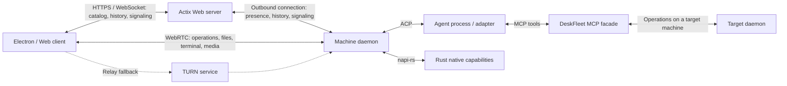

# DeskFleet architecture

DeskFleet manages AI agents and their working environments across a team's
computers. Users can browse workspaces and session history, inspect Git state,
and access terminals or desktops on the machine doing the work.

The central Actix Web API uses PostgreSQL for application sessions, Teams,
machine enrollment, access grants, and synchronized catalog/history. Electron
and the independently hosted Web app share the Vue UI and authenticated client
operations. Each TypeScript daemon connects outbound to the backend and keeps
its execution journal in SQLite through napi-rs. Management uses authenticated
backend APIs; Agent interaction, Git, files, terminals, and desktop streams use WebRTC.

The daemon runs from source, as a SEA executable, or inside the Electron main
process. It owns ACP providers, the shared backlog, steering, permissions,
Session archive/restore, and native media. Electron retains a sandboxed renderer
and stays in the tray after its windows close. The local discovery socket serves
host setup, enrollment, and shutdown; it does not authorize team resource access.
Session-scoped MCP tools and Scheduled Tasks run alongside those daemon services.

## Components



| Component | Responsibility | Implementation |
| --- | --- | --- |
| Central server | Team membership, machine registration, catalog, stored session history, presence, access control, and signaling | Rust / Actix Web |
| Machine daemon | Workspace configuration, agent supervision, ACP clients, terminals, Git access, and history synchronization | TypeScript library; Node.js SEA or bundled Electron host |
| Native libraries | OS integration and performance-sensitive transport, capture, input, and media work | Rust with napi-rs bindings |
| Desktop application | User interface, platform integration, and daemon installation/management | Electron / TypeScript |
| Web application | Independently hosted frontend for catalog, history, and browser-supported remote access | Vue / TypeScript |
| MCP facade | Let agents discover resources and operate on explicit remote targets | TypeScript, sharing DeskFleet client operations |

The server owns team membership and shared access policy. Each daemon owns its
machine's workspace configuration, files, processes, and live session state. The
server stores synchronized views so users can browse history while a machine is
offline; clients show when that data was last observed.

The backend is open source in this repository under Apache-2.0. Shared resource
and protocol types remain independent of Actix Web and Node-API.

Optional Statsig integration belongs to the shared JavaScript frontend. Web and
Electron renderers use a build-time client-public key for behavioral events and
UI gates/experiments; an absent key disables the integration. Electron permits
only the configured Statsig origins through its renderer Content Security Policy.
Verified billing conversions originate in the Rust server; a transactional
billing outbox delivers them independently from payment reconciliation. Frontend
actions and server conversions share account and Team identifiers.
Experiment decisions never grant authorization, subscription entitlements, or
quota capacity; those remain server and daemon responsibilities. The
[analytics guide](analytics.md) owns identity, event scope, and configuration.

### Multiple API instances

API instances share one PostgreSQL database and the same public service origin.
Each process owns its open WebSockets, while PostgreSQL owns expiring process
leases and the current process/connection identity for each machine. Management
requests reach that owner through a short-lived PostgreSQL inbox; responses,
client events, and revocation notices use the same routing. An HTTP request and
the daemon or client socket it addresses can land on different instances, without
load-balancer affinity or a separate message broker.

Machine reconnection atomically replaces the route. Connection identities fence
late responses and disconnect cleanup from the old socket. A database failure
or expired process lease stops that process from using its local sockets as
authority. Closing signaling for recovery does not revoke an already authorized
WebRTC connection or stop the daemon's execution.

Each daemon signaling socket also reconciles its peer grants from PostgreSQL at
its 20-second heartbeat. If a revocation commits but its broadcast is lost, the
next successful reconciliation closes the revoked peers while retaining active
ones. Snapshot reads and daemon request enqueueing share the local connection
gate, so a snapshot taken before a new peer's grant is enqueued before that
peer's offer and cannot close the new peer.

PostgreSQL also stores each peer's immutable SDP offer/options, completed answer,
and bounded early ICE candidates, so signaling HTTP calls can use any instance.
The daemon remains the owner of the actual WebRTC peer. Inbox delivery is
at-most-once with expiry; an API crash can interrupt an RPC or negotiation.
Callers check operation receipts before retrying commands and create a new peer
after a failed negotiation. These routing records are transient coordination
state, separate from durable conversation history.

The cross-instance inbox stores RPC parameters and results, including provider
environment values when a management operation carries them. Synchronized
provider catalog rows continue to omit those values. Inbox payloads expire after
120 seconds and are deleted on consumption or expiry cleanup, without being
logged by the router. Database backups can retain these operation payloads after
the inbox rows expire; the central database and its backups therefore remain
inside the trust boundary for that sensitive data.

Expiry maintenance runs independently of the routing poll and authentication
requests. A database claim permits one pass across API replicas every 30 seconds;
the server allows 20 seconds for a pass. Each identity table and the routing inbox
use deletion batches of at most 1,000 eligible rows, skipping locked rows.
Expired API-node deletion locks the parent before cascading to its routes and
messages, matching lease renewal's lock order. Login sessions, peer grants, and
durable history remain available to their existing consumers. Machine lists
resolve presence in one query against current node leases and revocation state.

Instances use the existing database configuration; process identities are
generated at startup. Redis remains specific to coturn statistics. The existing
PostgreSQL collector lease selects one TURN subscriber, and billing work uses
its existing database claims. See [deployment operations](self-hosted.md) for
replica configuration and failure behavior.

## Identity and team access

The identity design supports the hosted service and self-hosted installations with
DeskFleet-owned accounts with public email/password registration and Passkeys.
[Identity and billing requirements](identity-billing.md) define the accepted
plan model, account flows, and enforcement boundaries. Web sessions use HttpOnly
cookies; Electron exchanges a browser authorization for a secure main-process
credential. Stripe subscriptions belong to Teams; Enterprise is a separate
Site Admin override. Existing development databases must be rebuilt for this
schema; legacy identity/data migration is not supported.

The Rust backend is API-only. An independently hosted Vue
Web client and the Electron client share a common UI component package.
Creating resources requires an authenticated user and a selected Team.
Headless machines need enrollment into that Team before accepting
resource creation; their ongoing server connection uses machine credentials,
separate from a user's interactive login.

Team members can operate all machines in their Team by default. The initial
roles are administrator and member. Administrators manage members and roles and
remove machines. Members can enroll their own machines, configure Providers,
create or delete Workspaces, and create, archive, or restore Sessions. The first
release does not expose Session deletion to users. Per-Workspace sharing rules are not
part of the initial role model. Server and daemon authorization still checks the
requested action and Team rather than treating a connected peer as authority.

Site administrators have a separate installation-wide grant attached to their
existing user account. They manage runtime site settings and the target design's
manual Team Enterprise grants without selecting or joining a Team. A site grant
does not grant Team membership, machine access,
history access, or peer/MCP execution rights. Deployment operators explicitly
grant and revoke this role through the server's `site-admin` command; neither
the first login nor an email address confers authority. Each administrative API
operation reads the current grant, so existing login sessions observe revocation.

Central authorization uses resource policies with typed actions and explicit
`authorize` calls. `TeamPolicy` and `MachinePolicy` receive membership in the
target resource's actual Team; `SitePolicy` receives the current site grant.
`TeamScope` and `MachineScope` restrict collection queries in SQL. The policies
live alongside central store operations and do not depend on HTTP, so management,
signaling, and delegated Agent operations share the same Team rules. Existing
transaction checks, peer expiry/revocation, and daemon delegation bounds remain
part of authorization. Rules such as retaining a Team's final administrator are
transactional business invariants in addition to policy checks.

PostgreSQL owns runtime site name, announcement, Team-creation policy, and optional
Terms of Service and Privacy Terms URLs. The public site endpoint exposes these
fields; authenticated site administrators
can edit them in the Web client's Site administration page. The administration
UI is Web-only. Web and Electron both display the public site name and
announcement and apply the Team-creation setting. The creation switch applies to
all users, including site administrators, while existing Teams and invitations
remain usable. Settings writes and administrator grant/revoke
operations record their changes atomically in central site audit. Database URLs,
authentication configuration, service origins, and transport credentials remain
deployment configuration; machine-local settings remain owned by their daemons.

Authentication configuration also publishes the legal URLs. When either URL is
configured, the registration page requires explicit checkbox acceptance and the
registration endpoint rejects missing consent before issuing a mailbox challenge.
Both empty URLs preserve email-only registration. Recovery does not require this
registration agreement.

The current automatically created local Team and discovery-token actor are
development scaffolding for this flow. They do not establish authenticated Team
membership and must not authorize resource creation in the integrated product.
Local IPC remains a transport for the local client after enrollment. Existing
unauthenticated local data is development data; the first release does not
include an import flow for it.

The [backend implementation scope](backend.md) tracks the required capabilities,
existing local assumptions, delivery order, and acceptance criteria.

### Subscription and quota ownership

The target subscription model makes each Team the billing and entitlement
boundary, including single-member Teams. Central PostgreSQL owns subscription
coverage, Enterprise overrides, period-attributed TURN usage, and atomic Team
member/Session capacity admission. Enterprise overrides a paid subscription
without cancelling it. Self-hosted installations use the same authentication
system with unlimited allowances and no payment integration. The
[plan matrix](identity-billing.md#plan-matrix) owns exact limits.

The daemon remains the sole owner of Session execution. It obtains central
capacity admission before creating, forking, or restoring Sessions, including
scheduled creation. It enforces per-Session consumed turns at its new-turn
boundary and retains inherited usage on fork. Async catalog snapshots cannot
serve as a concurrent capacity-admission ledger. Paid coverage expiry gates new
work without relying on a peer reconnect; accepted work retains its lifecycle.

The server applies TURN allowances when granting new relay access. Previously
issued access keeps its original bounded lifetime after exhaustion or paid
expiry. Neither subscription limits nor Enterprise change Team authorization,
machine credentials, resource ownership, or existing peer expiry/revocation.

## Resource model

```text
Team
  Machine
    TerminalSessions [machine scope]
    AgentSessions [optional machine scope; no Workspace]
    Workspace
      Ordered directory paths [one or more; first is default]
      AgentSessions
        Managed Worktree [created and removed with the Session]
      TerminalSessions [machine, workspace, or worktree scope]
```

| Resource | Meaning |
| --- | --- |
| Team | Membership and shared access boundary |
| Machine | An enrolled daemon installation and its OS user execution context |
| Workspace | A named, machine-local configuration of one or more ordered directory paths |
| Worktree | An execution context owned by one Session; the catalog also keeps an internal main context for Workspace directories |
| Directory binding | An unnamed path with a stable position; position zero is the default directory |
| AgentSession | A session with its captured execution context and provider identity; ordinarily owned by a Workspace, or machine-scoped when started without one |
| TerminalSession | A terminal owned by one Machine, Workspace, or Worktree, with a separate cwd |

A Workspace must be created with at least one existing directory. Its paths are
ordered and have no user-assigned aliases; the first path is the default working
directory. The catalog stores these paths in one internal main Worktree created
in the same transaction. The UI presents them as Workspace directories, without
exposing that storage record as a separate Worktree. A new Workspace has no
Sessions to display. New-session composition targets the Workspace; an existing
Session exposes its own Worktree. Updating the Workspace changes its configured
directories without retargeting existing Session contexts.

Worktrees are not independently maintained resources. Each Session record owns
one Worktree record, created and destroyed with it. Creating a Session chooses
its context. A **worktree** Session allocates generated checkouts; destroying it
removes them. A **directory** Session records the Workspace's current paths and
works in them directly, including their uncommitted changes and non-Git
directories; destroying it removes only its records, never those files. The
choice is immutable. Sessions sharing directories are not isolated from each
other or from the user's own edits. For worktree contexts, the daemon creates detached Git worktrees
from the configured checkouts' HEAD commits, grouping paths in the same checkout
and preserving subdirectory positions. Uncommitted source changes are not copied.
The first path is the Session's default working directory. Workspace paths may
be non-Git for main-context terminals and directory Sessions; creating a worktree
Session requires Git-backed paths with a commit.

The Electron client can open its local Workspace directories in an installed
editor, external terminal, or system file manager. The default action opens the
first directory; each additional directory has its own action. Discovery and
launching belong to the client's native platform integration, with a maintained
application registry. The main process verifies that the requested Machine is
its daemon's active registration on the signed-in server, then resolves the
Workspace directory from the daemon's live catalog through the authenticated
`catalogList` management RPC. This read observes completed Workspace edits
without waiting for catalog replication. The renderer supplies resource IDs and
a directory position, never an executable or filesystem path.
This integration is unavailable for remote Machines and Web clients; it does not
start an editor on a remote daemon or create a forwarding connection.

Archiving is the normal way to finish using a Session. It closes the provider
and Session-owned terminals while retaining the Session, its Worktree and files,
queued inputs, conversation/tool history, terminal transcripts, and audit.
Archive never invokes Worktree destruction or deletes uncommitted or untracked
files. The machine must be online, and archive completes only after the daemon
confirms that the associated live resources have closed. Restoration keeps the
same Session identity and execution context and returns it to the active list
without starting processes. A later message resumes the provider where supported;
opening a terminal can create a new shell while retaining old terminal history.
Archived Sessions remain owned by their Workspace and continue to prevent its
deletion. Session deletion is not a first-release user operation; existing
destructive implementation paths are not archive handlers.

For example:

```text
Machine: development-box
  Workspace: storefront
    Directories:
      /code/storefront-web  [default]
      /code/storefront-api
    Session: investigate checkout failures
      Worktree: automatically generated checkouts for this Session
```

Each checkout retains its own Git state. Resource IDs are independent of names,
paths, and repository URLs. Resources on different machines remain distinct even
when they share a repository remote.

A terminal's scope determines its association and access policy. Its cwd can
change without reparenting the terminal. Machine and workspace terminals need no
placeholder worktree. Resource ownership itself does not sandbox a shell's
filesystem access.

### Catalog persistence

`deskfleet-store` persists resource catalogs with SeaORM. The first schema
contains `teams`, `machines`, `workspaces`, `workspace_sessions`, `worktrees`, and
`worktree_directories`. The main Worktree stores each Workspace's configured
paths; Session-owned Worktrees store derived paths. Shared types in
`deskfleet-model` remain independent of the ORM.

Resource primary keys and foreign keys are signed 64-bit integers, allocated by
their owning catalog database. SQLite uses `INTEGER PRIMARY KEY AUTOINCREMENT`;
the same SeaQuery migration renders PostgreSQL `BIGINT` identity columns.
Resource IDs cross JSON boundaries as decimal strings to preserve precision in
JavaScript. They are unique within their resource table and catalog database,
not independently allocated identities that can be merged across databases.
Identities such as public user IDs that need to conceal internal numbering use
UUIDv7 instead; no user table is introduced in this schema.

Parent foreign keys enforce the resource hierarchy. Teams and machines with
children cannot be deleted. A Workspace with Sessions cannot be deleted; deleting
one without Sessions removes its main Worktree and directory rows. Session deletion
cascades to its managed Worktree. Main Worktrees have no Session ID, and each
Workspace has exactly one main context. Directory rows are keyed by Worktree and
position, with no name column. Paths must be nonempty and unique in the ordered
collection; filesystem validation belongs to the daemon.

Workspace creation and updates write the main Worktree and its nonempty directory
collection atomically. Reads preserve directory order. The default directory is
always the first path, so no separate default flag can diverge from ordering.
The store is a persistence boundary, not an authorization boundary.

`deskfleet-migration` owns explicit, reversible SQLite catalog migrations. The
central server uses independent PostgreSQL migrations in `deskfleet-control-store`
and applies them before accepting requests. Central storage owns user identities,
login sessions, Team policy, enrollment, peer grants, and replicas qualified by
central machine and local resource IDs. The local journal retains SQLite-specific
SQL. Both stores have integration tests against their actual database engines.
See the [server guide](../../apps/server/README.md) for configuration and migration
commands.

The daemon opens the active machine's `catalog.db` through a thin `NativeCatalog`
napi binding after acquiring discovery. The initial directory is `machine/`;
later registrations use `machines/<uuid>/`, selected by `active-machine.json`.
The local catalog
keeps its persistent origin and integer machine/resource IDs. Enrollment binds
that origin to the central Team and Machine. Earlier unauthenticated development
data outside `machine/` is not imported into the enrolled machine.

Machine removal revokes its credential without removing the user's Team
membership or stopping accepted execution. Explicit re-enrollment closes the
old execution context and selects a new empty directory and origin. The old
directory remains at its original path, preserving Git worktree registrations
and history. The new identity may join the original Team or a different Team;
it never imports the previous registration's resources. Valid registrations
cannot be reset through this flow.

Authenticated backend management exposes catalog queries, Workspace
create/update/delete, and Session create/archive/restore. The daemon validates
Workspace paths as absolute, existing directories. There are no manual Worktree
mutations or user-facing permanent Session deletion. Changes synchronize to the
central catalog and notify Team clients. Workspace deletion never removes its
configured source directories, and retained archived Sessions block deletion.

The shared folder dialog lists directories through backend RPC on the selected
daemon. It returns the current path, parent, home, roots, and child directories.
Clients treat paths as opaque so browsing follows the target machine's rules.

Worktree Session creation allocates a durable ID and creates Git worktrees beneath
`<machine directory>/session-worktrees/<session ID>/` by default. The host's
`<daemon directory>/worktree-settings.json` can select an absolute root directory,
configured through Desktop Settings → Preferences → This computer. Each new
worktree Session reads the current preference and creates custom checkouts under
`<root>/<catalog origin>/<session ID>/`; the catalog origin keeps repeated local
IDs in different machine registrations separate. A changed root affects new
Sessions without restarting the daemon or moving existing checkouts. An
unavailable configured root fails creation instead of falling back to the
default disk. Directory Sessions continue to use their Workspace paths.

Ownership manifests remain beneath the machine's `session-worktrees/` directory
and record custom checkout locations independently of the current preference.
Provisioning failure rolls back partial checkouts. Archive
retains those checkouts and their local changes; disconnect never destroys them.
Internal destruction remains available for rollback and development tests only.

Electron reaches the backend through its main-process transport and narrow
preload bridge. Web uses its browser transport. `VITE_DESKFLEET_SERVER_URL`
selects the backend at build time for both clients; the UI cannot change it.
Desktop and Web development default to `http://localhost:8080`, while production
Web builds without that variable use the page's origin. Saved desktop account
addresses only scope credentials to that backend and never override the compiled
choice. Web authentication uses HttpOnly cookies, without storing the backend
address in browser storage.
Both use the selected central Machine identity for routes, caches, drafts, and
commands; integer local IDs do
not identify resources across machines. The UI displays synchronized history
while a machine is offline and attaches through WebRTC for live Agent, Git, and
terminal operations. The working directory remains separate from terminal
ownership. Failed Session provisioning remains visible without a fabricated
Worktree; terminal transcripts stay solely on the daemon.

## Daemon and session lifecycle

Settings → Appearance belongs to the client viewing the team. Language, color
theme, interface font, and terminal font are saved in the desktop profile's
`appearance.json`, or in browser-local storage for Web. They do not modify the
selected machine or synchronize through the backend. Changes apply to existing
client windows, including native desktop chrome and menus; new windows load the
saved preferences before mounting their UI. Font fields accept CSS `font-family`
lists, with an empty value restoring the application default. Theme cards preview
the application palette. The terminal font editor uses the same xterm surface as
live terminals, and its ligature preference updates both the preview and existing
terminals without recreating them.
Malformed or invalid saved desktop appearance uses defaults without rewriting
the file until a successful edit. Filesystem read errors remain visible errors.

The daemon runs as the OS user whose files, credentials, and tools the agents
use. Closing a window or losing a connection must leave ongoing work running.
Local clients connect over authenticated IPC, such as a Unix-domain socket or
Windows named pipe.

Desktop Settings has a persistent **Run local Agent** preference, enabled by
default. The app bundles `@deskfleet/daemon` and starts it in its own main
process, with the bundled native addon and runtime. The daemon's lifetime is the
app's: it keeps running while the app sits in the tray with no windows, and the
app waits for its cleanup before exiting. The app never spawns a separate daemon
process. The standalone Node.js SEA is the headless distribution of the same
daemon and runs independently of any desktop app.

Desktop first-run setup uses a welcome page: platform-specific permissions, then
account sign-in. macOS guides Full Disk Access, screen/system-audio recording,
and Accessibility. Linux guides screen sharing
and keyboard/mouse control through its desktop authorization dialog, without
Full Disk Access or macOS System Settings instructions. The host saves
the current step in `onboarding.json` under its user-data directory and resumes
it after restart. A profile that already has an account or desktop settings, but
no welcome file, is treated as finished so sign-in is not repeated and the local
Agent still starts. Startup starts or reuses the local Agent according to the
existing enabled preference. Windows clients skip the OS permission steps, as
do clients with local Agent startup disabled and no running daemon. An enabled
Agent that fails to start retains permission guidance so users can retry.
Users can defer an individual
permission without blocking account setup or unrelated Agent work.

After acquiring discovery and initializing local IPC, a macOS desktop-hosted
daemon checks permissions without prompting, reporting `checking` while that
silent inspection is pending. The welcome page requests each permission
through authenticated local IPC; native checks and requests run in the owning
daemon process. Returning from System Settings refreshes checks without opening
another prompt. Standalone startup requests its permissions automatically.
Full Disk Access requires enabling the host app or executable in System Settings
and may require restarting that host. File previews have no separate consent
button or per-Session dialog. On Linux Wayland, both hosted and standalone daemons
request combined screen and input access at startup. A daemon-owned portal
session supplies both Linux welcome permission steps; the guide shows pending
authorization and existing grants, and offers an explicit retry after denial.
Refreshing or advancing the guide does not request another grant. The session
and local restore token allow unattended viewer reconnects while the
user's desktop is logged in and unlocked. Viewer lifetimes do not own that grant;
daemon shutdown closes it. See [native media](media.md) for restoration and
runtime requirements. Settings displays OS permission status separately from
daemon availability; capture and encoding start only on explicit use.

Startup reuses an authenticated daemon already owning the discovery directory,
such as a standalone SEA, instead of hosting another. Explicitly disabling the
preference sends authenticated shutdown and waits for the discovery lease to be
released after cleanup. It ends live terminal processes but retains catalog and
terminal history. Quitting the app closes the daemon it hosts in the same way;
a reused standalone daemon is only disconnected. Disabling auto-start does not
kill a separately started daemon when the app next launches. Startup/shutdown
errors and retries appear in Settings.

The desktop app stays resident in the system tray (the macOS menu bar or the
Windows notification area), so its daemon and notifications stay available.
Closing its window or using an ordinary quit command hides it. The tray menu,
OS session end, or a termination signal quits the app and its hosted daemon.

Web clients use the browser Notifications API for task completion and pending
input alerts while the page is running. Web and Electron share the account-wide
task monitor, including its history baseline and event deduplication. The Web
account shell owns its monitor and live notifications across machine changes;
leaving the page stops observation, and account changes dismiss existing alerts.
Returning from the browser's page cache starts a fresh monitor.

Browser onboarding offers an explicit **Enable notifications** action before
continuing into the account UI. Only that click, or the corresponding action in
Notifications settings, requests browser permission. Denial, dismissal, and
skipping do not block setup. The onboarding decision and notification preferences
are stored per browser origin; the master and event switches remain independent
of the browser's permission. Settings reports denied or unavailable permission.
There is no push delivery after the page closes.

The daemon is the ACP client and owns local agent processes or adapter
connections. Each AgentSession belongs to a Workspace and captures its Worktree execution
context at startup; later edits to the Workspace must not silently retarget a
running session. Additional directories are exposed through the provider's
supported configuration or tools.

Settings also has an **Agents** section for the target machine's providers.
The daemon owns their names, templates, binary paths, and environment overrides
in `<daemon directory>/agent-providers.json`. Templates are immutable after
creation. A Session retains its configured provider ID, and each new provider
process resolves the current settings. Editing or removing a provider does not
stop existing processes or delete their history; a removed provider cannot
start again. Provider launch settings remain outside the Session journal.
The same daemon probes executable paths during provider creation. Explicit
installation and login actions run in machine-owned terminals, using official
installers and the selected CLI's authentication command. Their output and input
reuse the terminal channel. Connection tests use existing credentials and never
start interactive login. See [provider configuration](agent-sessions.md#provider-configuration).

The Codex template connects Codex CLI through the bundled
[Codex ACP adapter](https://github.com/agentclientprotocol/codex-acp). The Claude
Code template connects Claude Code CLI through the bundled
[Claude Agent ACP adapter](https://github.com/agentclientprotocol/claude-agent-acp).
The Cursor template launches the installed Cursor CLI directly as `agent acp`;
Cursor speaks ACP and does not use a bundled adapter. After initialization it
calls `authenticate` with `cursor_login` when Cursor advertises that method,
except during connection tests, which use credentials loaded at CLI startup.
The Grok template launches the installed Grok CLI directly as `grok agent stdio`.
It authenticates with `xai.api_key` when `XAI_API_KEY` is set, and otherwise with
`cached_token` after `grok login`.
The DeepSeek Harness template launches the installed `dsh` CLI directly as
`dsh --profile acp`. Credentials come from `DEEPSEEK_API_KEY` (optional
`DEEPSEEK_BASE_URL`); the ACP server does not advertise interactive authenticate
methods.
The shared
`AgentProvider` interface accepts a user-facing name, an optional binary path,
and environment overrides. Provider-specific code selects the process; the
[ACP TypeScript SDK](https://agentclientprotocol.com/libraries/typescript) handles
initialization, session creation and forking, prompts, cancellation, and session updates.
The SDK's unstable profile supplies `session/fork`; the negotiated ACP protocol
version remains `1`, and forking requires the provider's advertised capability.
Each bundled adapter uses the installed CLI and its credentials. Adapters run as
child processes; the SEA executable reuses its bundled Node runtime.
The generic ACP template launches a stdio ACP executable directly. Empty binary
paths use the template default (`codex`, `claude`, `agent`, `grok`, `pi`, `dsh`, or `acp-agent`), and configured environment
values extend the executing daemon's inherited environment. New installations
start with a default Codex provider; the new-session composer chooses among the
machine's configured providers. See [Agent Sessions](agent-sessions.md) for
configuration and lifecycle details.

The current agent CLI creates one ACP session per prompt invocation. With
`--workspace-id`, it asks the running daemon to allocate a managed Session and
uses its first derived directory as cwd. It closes the provider process before
destroying that Session and its generated Worktree, including on prompt or
initialization failure. Direct `--cwd` invocations remain outside the managed
Workspace lifecycle. Provider session IDs remain separate from database Session
IDs. The CLI forwards ACP updates without converting them into a history schema.
Permission requests require a client callback; without one they are cancelled.
The CLI cancels them explicitly. The ACP client advertises UTF-8 text-file reads
and writes on the executing machine, scoped to its open provider Session. It does
not advertise terminal capabilities. Managed Agent Sessions additionally provide
ACP v1 terminal callbacks using the daemon's terminal service. Those command
terminals belong to the Session's Worktree, retain their transcripts after ACP
release, and expose only read-only output to human viewers. The terminal
DataChannel carries their output without copying it into conversation history.

ACP capability negotiation determines which operations an adapter supports.
Pi is a further integration candidate. Managed
sessions, imported history, resumed sessions, and attachment to an existing CLI
process are distinct capabilities. ACP alone does not guarantee live attachment;
a tmux connection can expose the CLI without providing structured ACP control.

The [Agent Session service](agent-sessions.md) persists provider identity,
inputs, execution turns, command audit, permissions, user questions, and an ordered event journal
in the daemon's SQLite catalog. Clients connect to a daemon ACP facade over
DataChannel; the daemon remains the sole ACP client toward each provider process.
Credentials remain on the executing machine. ACP approval callbacks do not confine
agents that execute tools directly.

The composer discovers model, reasoning, and mode choices from the provider through the
same ACP DataChannel facade. Draft discovery uses a temporary provider session in
the Workspace's default directory without creating a managed Session or Worktree.
Session creation applies the selected configuration before delivering prompts;
existing Session controls change these choices between turns on that Session's
provider connection. A Session's provider identity cannot be changed.
Configuration options and confirmed changes use the existing ACP event journal
so attached viewers can follow them.

Composer completions share this provider discovery for `/` commands and supported
`$` skill invocations. `@` file search runs on the target daemon across the
Workspace draft or Session's captured directories; draft references resolve in
the new Session's context after creation. `@` Session references use the existing
MCP history tools within the same Workspace, including archived conversations.
These references share attachment serialization and do not expand delegated
authority. Machine-scoped composition has no `@` candidates. The
[Agent Session guide](agent-sessions.md#composer-references-and-commands) owns
completion, serialization, and command queue semantics.

All authorized users and devices can operate on a Session concurrently, without
control ownership or transfer. Commands record the initiating user and source
machine separately from the executing machine. Pending inputs appear in a shared
candidate backlog; users can also explicitly steer the active turn when the
provider supports it. The daemon coordinates input delivery and permission
decisions and structured user questions, with the first valid response resolving
each shared request.
Reconnecting clients attach by journal cursor without resubmitting inputs.
Disconnect never grants approval or stops the Session.

Daemon restart recovery depends on the provider and terminal backend. Reconcile
stored history with available processes and report interrupted sessions. On
supported Unix systems, tmux can keep terminals alive across daemon restarts;
other PTY backends expose their own recovery capabilities.

## Remote access and coordination

Machines make outbound connections to the central server. Peer connections are
created on demand.

| Traffic | Transport |
| --- | --- |
| Authentication, enrollment, catalog, and history | HTTPS |
| Workspace, Provider, and machine-settings management | HTTPS API; server authorizes and forwards to the owning daemon |
| Presence, history synchronization, and WebRTC signaling | Authenticated WebSocket or HTTPS streams |
| Terminal dial, hangup, catalog and lifecycle events | Authenticated signaling; IPC for the local client |
| Interactive operations, Git queries, terminal I/O and resize | WebRTC DataChannel |
| Agent prompts, steering, permissions, and live Session events | ACP and DeskFleet extensions over WebRTC DataChannel |
| File browsing, transfer, and Agent file references | Independently authorized files WebRTC DataChannel |
| Desktop loopback TCP port forwarding | Independently authorized ports WebRTC DataChannel; byte transport stays in Rust |
| Desktop video/audio | WebRTC media tracks |
| Desktop input | WebRTC DataChannel |
| Local discovery, catalog operations, and signaling | Authenticated IPC; Agent and terminal streams use DataChannels |

Deploy STUN and TURN alongside signaling. TURN provides relay access when peers
cannot connect directly. Desktop streaming, terminal traffic, and bulk results
need flow control appropriate to their latency and throughput; validate this
with the selected WebRTC implementation.

Desktop's programmatic [TCP forwarding](ports.md) API owns local loopback
listeners in its main process, independently of windows and the local Agent.
The target daemon enables native forwarding only for a `ports:forward` grant.
Forwards are ephemeral Machine connections, without UI controls or a new
catalog resource; closing them does not stop the target service.

The central backend optionally collects coturn Redis Pub/Sub counters by Team
and stores them in PostgreSQL. See
[Team TURN usage collection](self-hosted.md#team-turn-usage-collection) for setup
and collection limits.

The native transport uses `webrtc-rs` with configurable STUN/TURN servers,
trickle ICE, reliable ordered DataChannels, RTP media tracks, and RTCP feedback.
`PeerSessions` gives the daemon ownership of peer creation and shutdown. These
are exposed to the local Electron client over authenticated Unix-domain sockets
or Windows named pipes. Central server signaling, remote enrollment, and remote
operation routing use the authenticated control plane. Chromium receives the media into a
standard HTML video element; a separate native GPU rendering window is deferred.
See [native media](media.md) for codec support, capture lifecycle, and validation.

The [WebRTC key exchange design](webrtc-security.md) uses trusted HTTPS/WSS
signaling to bind authenticated user/device and target Machine identities to
each peer's SDP fingerprints. The endpoints perform standard DTLS certificate
verification and key exchange; DataChannels use DTLS and media uses DTLS-SRTP.
The server does not receive private transport keys. Each new peer uses a new
authorization and endpoint-generated certificates, distinct from login and
machine enrollment credentials. No additional application encryption protocol
or independently verified device-pairing mechanism is part of the first release.

Electron terminals use a data-only peer on the same signaling infrastructure.
The daemon owns native PTYs independently of their viewers; disconnect detaches,
and an existing terminal can be listed and reattached without restarting its
shell. The UI supports local machine-scoped terminals. See
[terminal integration](terminals.md) for dial/hangup, durable history, and flow
control.

Git inspection uses the Git CLI's machine-readable output on the owning daemon.
Session-scoped queries resolve the captured directories to their checkouts and
retrieve branch, HEAD, staged/unstaged/untracked status, and file diffs. Several
bindings in one checkout share its result; non-Git directories remain usable and
are identified separately. Queries use the existing ACP DataChannel and do not
write history or change the index. The visible Changes panel subscribes to
transient Git invalidations over that channel. The daemon shares filesystem
observation and status reads by canonical checkout root, including the working
files and the checkout's resolved Git metadata directories. Git-ignored,
untracked directory trees are excluded from observation. Changes from terminals
and external editors invalidate the cached snapshot; the client uses VueUse's
300 ms debounce with a 2 second maximum wait to refresh status and its open diff.
Invalidations arriving during a read cause a subsequent read, even when the file
status and line counts are unchanged. There is no periodic Git polling.

Subscriptions attach before the initial read and are released when the panel is
closed, the window is hidden, the connection closes, or the Session is archived.
The last subscriber releases the checkout's watchers and cache. Reopening or
reconnecting establishes fresh observation and rereads Git; manual refresh can
bypass cached status. Watch failures are reported to the viewer, which retains
manual refresh and retries observation on request. An unavailable directory
binding keeps its error visible without disabling observation of healthy
checkouts in the same Session. Non-Git directories are
observed within their captured roots; creating a repository above such a root
requires reopening the panel to discover the enclosing checkout. These
observers track changes to explicit `core.excludesFile` paths; changes to Git's
implicit global ignore file also require reopening. Notifications require
`git:read` and are not Agent journal events. Git results remain transient;
Session provisioning still owns creation
and deletion of managed worktrees.

The machine's Remote control page groups Terminal, Desktop, File transfer, and
System status. The current Electron client's own daemon is identified by its
active registration with the signed-in server and marked as the local machine.
Its Local control page omits Desktop and defaults to Terminal, retaining File
transfer and System status. Locality is client-relative; the machine's advertised
desktop capability remains available to other clients. Web clients have no local
daemon, so their machine controls remain remote.
Tools mount when first visited and retain their connections while switching tabs.
Machine-owned shells live here; Session-owned shells stay in the Session panel.
System status reads CPU usage, physical memory, swap, and machine details from
the owning daemon's native collector through the authenticated machine management
RPC. The client refreshes every two seconds while the panel is visible and the
machine is online, pauses when its tab or window is hidden, and retains recent
samples only in the mounted panel for CPU and memory trends. Failed reads leave
the last sample visibly stale; these measurements are not persisted in the central
catalog or Agent history. Native sampling runs off Node's event loop and is shared
by concurrent reads without a background polling service.

Machine file access shares one service between the two-pane transfer panel and
Agent Markdown resources. File peers and the transfer queue have independent
lifetimes from Sessions and desktop media. Electron's main process owns its
queue and local filesystem endpoint; Web owns its queue at page/account scope
and uses explicitly selected browser directory handles. A folder is one queue
item, with its contents staged before native publication. Relative Agent file
references resolve against the Session's captured first directory. See
[files and transfers](files.md) for authorization, conflicts, browser limits,
and live-reference semantics.

MCP tools let an agent discover authorized machines and resources, inspect state,
and request operations on an explicit target. Remotely created sessions belong
to worktrees on that target machine. The agent coordinates related work across
machines; DeskFleet does not create a global Project or synchronize repository
contents automatically.

The independent `@deskfleet/mcp` stdio server is injected into managed ACP
Sessions. Its built-in tools share the same operations as human clients, with a
delegation restricted to the issuing Session's Workspace and current Team
membership checked on every call. Settings configures additional MCP servers
separately; the built-in server is always injected. Cross-machine delegation
remains subsequent work. The [Scheduled Tasks and MCP guide](scheduled-tasks.md)
owns timing, persistence, authorization, and provider injection details.

## History and authorization

The central server stores synchronized conversation and tool history, not just
session names. The daemon retains unsynchronized events during server outages.
Synchronization must tolerate retries and distinguish incomplete history from a
complete recording. The [Agent Session persistence design](agent-sessions.md)
extends the SQLite/SeaORM catalog with command audit and a per-Session sequence.
The daemon commits events before publishing them; the server synchronizes a
qualified Session identity and completeness watermark. The owning daemon remains
the single writer even when multiple clients operate concurrently.

Live commands require an available target machine. Terminal output is persisted
on the owning daemon until explicit hangup so a different client can reconstruct
the session. Reconnecting does not restart the shell. Daemon restart retains the
transcript and marks lost processes interrupted. Desktop media remains transient.

Authorize history access, prompts, approvals, terminal input, and desktop control
as separate actions. Both the server and target daemon enforce the caller's
scope. Authenticate remote peers and local IPC callers; a WebRTC connection or
signaling access alone does not authorize machine operations.

Agent MCP calls carry delegated authority. Generated arguments cannot broaden
that authority, and discovery exposes only permitted resources. Remote actions
remain attributable to their initiating user/session and target resource.

The first backend release assumes the central service is available for login,
enrollment, authorization, and management. It does not add offline resource
creation or a separate offline-authorization system. An established, authorized
WebRTC connection can continue working when its signaling connection is lost,
within its existing grant. A grant ends on peer closure, explicit revocation,
or 24 hours after issuance, whichever comes first. The daemon enforces expiry
even without signaling, and reconnecting signaling does not extend it. Renewal
uses current authentication and a new peer. Logout, membership removal, and
machine removal revoke the affected peers; notices take effect when delivered,
with expiry bounding access if the control connection is unavailable. Revoking
access or expiring a peer detaches viewers without cancelling Agent execution,
terminating shells, or archiving a Session. Details are owned by the
[peer authorization lifecycle](webrtc-security.md#authorization-lifetime-and-revocation).

The initial design trusts the server with synchronized Agent conversations,
tool history, and audit. Terminal output remains on the daemon. Archive and
restore preserve all this data, including content-bearing audit records.
Permanent Session deletion is deferred from the first user-facing release.
When introduced, it removes central conversation/tool content, including raw
content in audit parameters and results; only audit metadata remains, and stale
uploads must not restore removed content. Keep machine private keys and
application credentials out of history and logs. Electron renderers stay
sandboxed, with narrow preload interfaces; agent output and repository content
are untrusted display data.

## Native code and distribution

Keep reusable Rust logic separate from napi-rs wrappers, following Heron's
core-crate, binding, and TypeScript-service structure. Native operations must
avoid blocking Node's event loop. Keep capture and encoding data in native code
where passing frames through JavaScript would add unnecessary copies.

Node.js SEA packages the daemon and native addon with the pinned Node runtime.
The addon is extracted to a private temporary directory before loading. See the
[daemon guide](../../apps/daemon/README.md) for packaging and platform support.
Desktop builds bundle the same daemon library with Electron and an unpacked
native addon. Neither distribution requires an external Node installation.
Agent adapters and external tools may have their own runtime requirements.

Desktop capability is optional and initialized on demand. Missing displays or
capture permissions must not prevent agents, Git, or terminals from working.
Determine whether capture needs a process in the logged-in graphical session
when implementing the platform backend.

## Repository and protocol

The Rust workspace contains:

| Crate | Responsibility |
| --- | --- |
| `deskfleet-model` | Resource IDs, directory bindings, and session associations |
| `deskfleet-store` | SeaORM entities and transactional catalog persistence |
| `deskfleet-migration` | Catalog schema migrations and optional migration CLI |
| `deskfleet-protocol` | Shared wire contracts and protocol version |
| `deskfleet-control-store` | PostgreSQL central identity, authorization, catalog, and history persistence |
| `deskfleet-native` | Native capabilities independent of Node.js |
| `deskfleet-capture` | Native display capture and retained GPU surfaces |
| `deskfleet-input` | Display-relative desktop input, held-state cleanup, and macOS/Windows injection |
| `deskfleet-encoder` | VideoToolbox/NVENC/Media Foundation hardware video encoding and Opus audio encoding |
| `deskfleet-nvenc` | Windows NVENC session and D3D11 resource ownership |
| `deskfleet-nvenc-sys` | Windows NVENC FFI and runtime driver loading |
| `deskfleet-node` | napi-rs wrapper over native capabilities |
| `deskfleet-server` | Actix Web application in `apps/server` |

Dependencies flow `server -> protocol -> model`, `server -> control-store -> protocol`,
`node -> store -> model/migration` for local catalog persistence,
`node -> native -> capture/encoder/input`, and
`@deskfleet/daemon -> @deskfleet/native`. The pnpm workspace contains the daemon,
Electron and Web applications, the native package, `packages/client` for shared
contracts/transports, `packages/components` for Vue UI, stores, and routes, and
`packages/mcp` for the independent Agent tool server.
TypeScript control wire types derive from the Rust protocol crate; napi
declarations describe the native API separately.

`PROTOCOL_VERSION` stays at `1` until the first freeze is explicitly declared.
Contracts evolve in place, including incompatible changes. Do not add version
bump tasks or compatibility layers for earlier provisional shapes.

mise manages tools and tasks with lockfile mode enabled. APM owns the checked-in
skills. See the [development environment](environment.md), [CI workflow](ci.md),
and [agent guide](../../AGENTS.md) for repository conventions.

## Backend acceptance

The [backend implementation scope](backend.md) covers identity and Teams,
PostgreSQL, enrollment, authorized management APIs, signaling, synchronized
catalog/history, reversible Session archive, and the shared Vue component
package with an independent Web client. The acceptance workflow in both Electron
and Web is: log in, select a Team,
enroll a headless machine, configure a Workspace, create a Session with its
execution context, run an Agent, inspect its Git state from another machine,
and open a terminal. Work continues after closing the client, reconnecting
restores the Session view, and synchronized history remains available while the
machine is offline. Validate direct and TURN-relayed connections.

Cross-machine MCP coordination follows that workflow. Bundling provider binaries,
additional terminal backends, and Linux capture/encoding remain
separate follow-up work.

## References

- [Actix Web](https://actix.rs/docs/getting-started/)
- [ACP transports](https://agentclientprotocol.com/protocol/v1/transports)
- [ACP capabilities](https://agentclientprotocol.com/protocol/v1/initialization)
- [ACP session setup](https://agentclientprotocol.com/protocol/v1/session-setup)
- [WebRTC connectivity](https://webrtc.org/getting-started/peer-connections)
- [Node.js SEA native addons](https://nodejs.org/api/single-executable-applications.html#using-native-addons-in-the-injected-main-script)
- [Node-API ABI boundaries](https://nodejs.org/api/n-api.html#implications-of-abi-stability)
- [Electron sandboxing](https://www.electronjs.org/docs/latest/tutorial/sandbox)
- [Heron napi crate](https://github.com/minori-live/heron/blob/main/crates/dsp-node/Cargo.toml)
- [Heron native packaging](https://github.com/minori-live/heron/blob/main/apps/desktop/electron-builder.yml)
