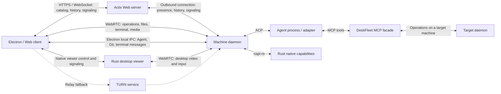

# DeskFleet architecture

DeskFleet manages AI agents and their working environments across a team's
computers. Users can browse workspaces and session history, inspect Git state,
and access terminals or desktops on the machine doing the work.

The central Actix Web API uses PostgreSQL for application sessions, Teams,
machine enrollment, access grants, and synchronized catalog/history. Electron
and the Web app share the Vue UI and authenticated client operations. Each
TypeScript daemon connects outbound to the backend and keeps
its execution journal in SQLite through napi-rs. Management uses authenticated
backend APIs. Remote Agent interaction, Git, files, terminals, and desktop
streams use WebRTC. Electron uses a direct authenticated channel for Agent, Git,
and terminal messages on its registered local machine.

The daemon runs from source, as a SEA executable, or inside the Electron main
process. It owns ACP providers, the shared backlog, steering, permissions,
Session archive/restore, and native media. Electron retains a sandboxed renderer
and stays in the tray after its windows close. The local discovery socket serves
host setup, enrollment, and shutdown; it does not authorize team resource access.
Session-scoped MCP tools and Scheduled Tasks run alongside those daemon services.

The Linux, Windows, and macOS desktop clients can also open a remote desktop in a separate native
viewer process. Electron retains authentication, peer grants, and signaling;
the viewer owns only its window, receiving media peer, decoder, input forwarding,
and GPU presentation. The machine daemon continues running inside Electron's
main process. Native viewer closure releases that viewing session without
changing the daemon's lifetime.

The native desktop viewer uses a GPUI host with a pure-Rust NSH floating
toolbar. Its video scene and toolbar share one window compositor; decoded pixels
stay in Rust and never pass through the NSH engine. The toolbar uses the shared
desktop translations and theme, with display selection, control settings,
pause/resume, full screen, and disconnect/reconnect. One viewer process keeps
its window while Electron replaces or stops the receiving peer. Per-window
platform hooks forward physical keyboard positions through the existing input
contract. The [native viewer guide](media.md) records runtime validation and
GPUI presentation measurement limits.

## Components



| Component | Responsibility | Implementation |
| --- | --- | --- |
| Central server | Team membership, machine registration, catalog, stored session history, presence, access control, signaling, and optional Web static hosting | Rust / Actix Web |
| Machine daemon | Workspace configuration, agent supervision, ACP clients, terminals, Git access, and history synchronization | TypeScript library; Node.js SEA or bundled Electron host |
| Native libraries | OS integration and performance-sensitive transport, capture, input, and media work | Rust with napi-rs bindings |
| Desktop application | User interface, platform integration, and daemon installation/management | Electron / TypeScript |
| Native desktop viewer | Optional independent remote desktop window, receiving media, input forwarding, and bounded decoded-frame queue | Rust / NSH / GPUI; platform H.264, HEVC, and AV1 decoding |
| Web application | Frontend for catalog, history, and browser-supported remote access, served by the central server or an independent static host | Vue / TypeScript |
| MCP facade | Let agents discover resources and operate on explicit remote targets | TypeScript, sharing DeskFleet client operations |

The server owns team membership and shared access policy. Each daemon owns its
machine's workspace configuration, files, processes, and live session state. The
server stores synchronized views so users can browse history while a machine is
offline; clients show when that data was last observed.

The backend is open source in this repository under Apache-2.0. Shared resource
and protocol types remain independent of Actix Web and Node-API.

Optional Statsig integration belongs to the shared JavaScript frontend. Web and
Electron renderers use a build-time client-public key for behavioral events and
UI gates/experiments; an absent key disables the integration. Electron permits
only the configured Statsig origins through its renderer Content Security Policy.
Verified billing conversions originate in the Rust server; a transactional
billing outbox delivers them independently from payment reconciliation. Frontend
actions and server conversions share account and Team identifiers.
Experiment decisions never grant authorization, subscription entitlements, or
quota capacity; those remain server and daemon responsibilities. The
[analytics guide](analytics.md) owns identity, event scope, and configuration.

Optional Sentry error reporting also belongs to the shared Vue frontend. Web
and Electron renderers use a build-time public DSN; an absent or invalid DSN
disables reporting. Each renderer captures Vue and unhandled JavaScript errors,
including errors from its separate machine-surface applications. Electron also
passes bounded central API diagnostics and client runtime metadata through
its preload bridge; the renderer owns reporting. Both client adapters report
handled transport, response decoding, rate-limit, and server failures after
their public API operation has finished internal recovery. Callers explicitly
scope known background work and user actions; unclassified calls remain unknown.
The shared renderer bounds repeated background network/server reports and emits
occurrence counts; it retains individual user-action and unknown failures.
Electron permits only the DSN's origin through its renderer Content Security Policy. The
[error-reporting guide](error-reporting.md) owns configuration and collected data.

All product-owned TypeScript JSON API calls use `packages/client/src/api-request.ts`,
backed by Ky. Web/Electron account requests, daemon backend requests, and the
loopback MCP gateway share timeout, retry, JSON decoding, and error normalization.
The transport retains HTTP status, API error codes, supported recovery reasons,
and bounded diagnostics; business callers decide how to present or act on them.
Streaming MCP connections remain with the MCP SDK, binary assets use their
resource transports, and the Rust backend's external HTTP clients use reqwest.

GET/HEAD requests retry transient network failures, per-attempt timeouts, and
HTTP 408/429/500/502/503/504 at most twice. Ky owns exponential backoff and
`Retry-After` handling. Reads default to five seconds per attempt and fifteen
seconds total, including waits and response decoding. Network configuration
keeps its five-second total budget and also retries transient route 404s.
Writes default to a single attempt with a 65-second deadline, allowing the
backend's 60-second RPC/negotiation deadline to return a structured error.
Operations with explicit shorter deadlines keep them. Retry eligibility does not
change these timeout budgets. Admission writes opt into retries using their
stable operation IDs and generations; generic RPC, MCP tools,
authentication, checkout, and peer mutations are not automatically replayed.
Catalog/history synchronization retains its own durable retry mechanism.
Caller cancellation and daemon shutdown stop active requests and backoff waits.

### Multiple API instances

API instances share one PostgreSQL database and the same public service origin.
Each process owns its open WebSockets, while PostgreSQL owns expiring process
leases and the current process/connection identity for each Team registration.
One physical daemon opens an independent control connection for each registration;
routing uses its internal registration ID, so another Team's connection cannot
replace it. Management requests reach that owner through a short-lived PostgreSQL inbox; responses,
client events, and revocation notices use the same routing. An HTTP request and
the daemon or client socket it addresses can land on different instances, without
load-balancer affinity or a separate message broker.

Machine reconnection atomically replaces the route. Connection identities fence
late responses and disconnect cleanup from the old socket. A database failure
or expired process lease stops that process from using its local sockets as
authority. Closing signaling for recovery does not revoke an already authorized
WebRTC connection or stop the daemon's execution.

An established control socket is not recovered by its close handshake alone: a
dead peer never answers it and the WebSocket implementation has no closing
deadline. The daemon and the client signaling socket therefore declare a link
dead after 60 seconds without traffic, abandon it when an orderly close does not
finish within 2 seconds, and reconnect with bounded backoff starting at 1 second.
The daemon reports `connected` false as soon as the link is declared dead, so a
lost link cannot leave a machine offline until its process restarts.

After client signaling reconnects, opened machine adapters wait for the account's
shared machine roster read before refreshing their catalog, history, providers,
and terminal list. Presence notifications and renames do not complete that read.
Terminal lists retain their cached entries while reconciliation is pending or the
machine is offline; unchanged online machines still refresh after reconciliation.
Roster reads started before a signaling connection change are discarded. This
reconciliation preserves already authorized peers and their live streams.

Browser and installed-PWA pages suspend timers while hidden, so heartbeat ticks
alone cannot time out a stale socket. Heartbeat traffic is skipped while the
page is hidden. Returning to a visible page, restoring a page from the
back/forward cache, or receiving an `online` event probes a recently active
socket with an immediate ping and replaces it only when the 3-second round trip
misses. A socket idle beyond the 60-second deadline is replaced immediately, and
a pending retry is executed without waiting for its backoff.

Each daemon signaling socket also reconciles its peer grants from PostgreSQL at
its 20-second heartbeat. If a revocation commits but its broadcast is lost, the
next successful reconciliation closes the revoked peers while retaining active
ones. Snapshot reads and daemon request enqueueing share the local connection
gate, so a snapshot taken before a new peer's grant is enqueued before that
peer's offer and cannot close the new peer.

PostgreSQL also stores each peer's immutable SDP offer/options, completed answer,
and bounded early ICE candidates, so signaling HTTP calls can use any instance.
The daemon remains the owner of the actual WebRTC peer. Inbox delivery is
at-most-once with expiry; an API crash can interrupt an RPC or negotiation.
Callers check operation receipts before retrying commands and create a new peer
after a failed negotiation. These routing records are transient coordination
state, separate from durable conversation history.

The cross-instance inbox stores RPC parameters and results, including provider
environment values and one-use local-channel claim secrets when their operations
carry them. Synchronized
provider catalog rows continue to omit those values. Inbox payloads expire after
120 seconds and are deleted on consumption or expiry cleanup, without being
logged by the router. Database backups can retain these operation payloads after
the inbox rows expire; the central database and its backups therefore remain
inside the trust boundary for that sensitive data.

Expiry maintenance runs independently of the routing poll and authentication
requests. A database claim permits one pass across API replicas every 30 seconds;
the server allows 20 seconds for a pass. Each identity table and the routing inbox
use deletion batches of at most 1,000 eligible rows, skipping locked rows.
Identity, realtime, and TURN retention run independently under that shared
deadline. A failed or stalled category cannot skip the others; diagnostics name
the category and include safe database error fields. TURN retention atomically
compacts up to 10,000 raw notifications older than seven days per pass, keeping
exact billing counters in Team/minute archives.
Expired API-node deletion locks the parent before cascading to its routes and
messages, matching lease renewal's lock order. Login sessions and durable history
remain available to their existing consumers. Peer grants retain a 24-hour cleanup
window after expiry before bounded deletion. Machine lists
resolve presence in one query against current node leases and revocation state.

Instances use the existing database configuration; process identities are
generated at startup. Redis remains specific to coturn statistics. A separate
PostgreSQL lease selects the Cloudflare TURN analytics collector. Its replaceable
Team/key/period snapshots add to coturn usage for Team allowances; private
provider settings and issued ICE snapshots remain backend-owned. The existing
PostgreSQL collector lease selects one coturn subscriber, and billing work uses
its existing database claims. See [deployment operations](self-hosted.md) for
replica configuration and failure behavior.

## Identity and team access

The identity design supports the hosted service and self-hosted installations with
DeskFleet-owned accounts with public email/password registration, Passkeys, and
optional GitHub and Google OAuth login.
GitHub App integration is separate from login: central PostgreSQL stores each
user's App authorization and their opt-in to act as that GitHub user. App grants
belong to the account, not to a Team or Machine, and do not grant DeskFleet
resource access. The server retains App credentials and user tokens; clients
receive only connection settings and PR summaries. With Act as you enabled, the
server reads branch PR status using the user's App grant, refreshing expired
access tokens under a database lock before use. Installation management and user
authorization remain separate from login; no PR writes are performed.
[Identity and billing requirements](identity-billing.md) define the accepted
plan model, account flows, and enforcement boundaries. Web sessions use HttpOnly
cookies; Electron exchanges a browser authorization for a secure main-process
credential. Stripe subscriptions belong to Teams; Enterprise is a separate
Site Admin override. Existing development databases must be rebuilt for this
schema; legacy identity/data migration is not supported.

The Vue Web client and the Electron client share a common UI component package.
Below 1024 CSS pixels, a Session shows one full-width view at a time.
Chat, Changes, each terminal, and each preview form one ordered list without
nested tabs or a two-dimensional window layout. The title bar zooms the content
out into a three-column overview. Existing view instances keep their DOM parents
and original layout dimensions while their live surfaces scale and move into
cards. Selecting a card animates it back to full size. Preview content is inert;
the overview scrolls vertically and closes with its title-bar button or Escape.
Unopened terminals show placeholders. Only selecting a terminal view, including
committing a horizontal swipe to it, mounts its renderer and attaches to the shell.
Opening the overview or canceling a swipe does not attach unopened terminals.
The sidebar uses a Reka UI Drawer bottom sheet with opening and closing
animations and swipe-to-dismiss. It closes on navigation and does not overwrite
saved desktop panel widths or open states.

Horizontal swipes across the content viewport select adjacent views without
relying on screen-edge strips that conflict with mobile OS back gestures.
Horizontally scrollable containers retain native horizontal scrolling via CSS
`touch-action`, and pannable diagram, image, or 3D model canvases keep their
own drag behavior. Once a horizontal window swipe locks its axis, a non-passive
`touchmove` listener and `overscroll-behavior-x: none` prevent mobile browsers
from treating mid-screen horizontal swipes as history navigation. The viewport
returns to its current view at either end of the list or after a canceled
gesture.
Opened views stay mounted during view changes, which preserve drafts, scroll
positions, and terminal connections. Explicit terminal closure still ends its
shell. Mobile touch surfaces disable browser pinch and double-tap zoom while
retaining native scrolling. The Web viewport sets `maximum-scale=1.0` to prevent
Safari from zooming when an input receives focus, without changing input font
sizes. WebKit applies this limit to focus zoom separately from manual pinch zoom
([viewport properties](https://developer.apple.com/library/archive/documentation/AppleApplications/Reference/SafariHTMLRef/Articles/MetaTags.html),
[focus zoom implementation](https://github.com/WebKit/WebKit/blob/main/Source/WebKit/UIProcess/API/ios/WKWebViewIOS.mm)).

Settings moves section navigation above its content below 768 CSS pixels;
the same narrow layout puts account controls above the no-machine or no-team
onboarding content.
The official server image bundles the same-version Web build, served by the
Actix process alongside `/api/*` and `/healthz`. `DESKFLEET_WEB_DIRECTORY` enables
static hosting for a binary deployment; leaving it unset keeps the binary
API-only for independent static hosting or the local Vite development server.
Web static hosting serves the application entry point at `/` and `/auth/*`,
while missing API routes and assets remain 404 responses. TLS termination,
PostgreSQL, SMTP, and TURN remain separate deployment services.
Creating resources requires an authenticated user and a selected Team.
Headless machines need enrollment into that Team before accepting
resource creation; their ongoing server connection uses machine credentials,
separate from a user's interactive login.

Team members can operate all machines in their Team by default. The roles are
owner, administrator, and member. Each Team has exactly one owner, initially its
creator. Only the owner manages billing, deletes the Team, or transfers ownership.
Owners and administrators manage members and roles and remove machines.
Administrators cannot remove or demote the owner; the owner must transfer
ownership to an existing active, verified member before leaving. The former owner
becomes an administrator. Members can enroll their own machines, configure Providers,
create or delete Workspaces, and create, archive, restore, or delete Sessions.
The archived Sessions page exposes deletion after a hold-to-confirm action.
Per-Workspace sharing rules are not part of the initial role model. Server and
daemon authorization still checks the requested action and Team rather than
treating a connected peer as authority.

Site administrators have a separate installation-wide grant attached to their
existing user account. They manage runtime site settings and the target design's
manual Team Enterprise grants without selecting or joining a Team. A site grant
does not grant Team membership, machine access,
history access, or peer/MCP execution rights. Deployment operators explicitly
grant and revoke this role through the server's `site-admin` command; neither
the first login nor an email address confers authority. Each administrative API
operation reads the current grant, so existing login sessions observe revocation.

Central authorization uses resource policies with typed actions and explicit
`authorize` calls. `TeamPolicy` and `MachinePolicy` receive membership in the
target registration's Team; `SitePolicy` receives the current site grant.
`TeamScope` and `MachineScope` restrict collection queries in SQL. The policies
live alongside central store operations and do not depend on HTTP, so management,
signaling, and delegated Agent operations share the same Team rules. Existing
transaction checks, peer expiry/revocation, and daemon delegation bounds remain
part of authorization. Rules such as retaining a Team's unique owner are
transactional business invariants in addition to policy checks.

Enrollment, invitations, Team rename, and Machine rename/removal retain
authorization until commit: they lock the actor against disabling, then the Team against
membership changes, and check current membership before writing. Session
admission also locks the Team before the Machine and rechecks revocation after
waiting. Billing reconciliation and Checkout writes lock the Team before its
profile and analytics outbox, matching Enterprise updates and the outbox's
foreign-key checks. Checkout writes recheck the billing lease after acquiring
the profile lock and retain that lock through commit.
Ownership transfers lock both accounts before the Team so disabling either
account cannot race the ownership change. Invitation acceptance holds the
invitee's active status and email through commit and returns the role observed
inside that transaction.

PostgreSQL owns runtime site name, announcement, Team-creation policy, and optional
Terms of Service and Privacy Terms URLs. The public site endpoint exposes these
fields; authenticated site administrators
can edit them in the Web client's Site administration page. The administration
UI is Web-only. Web and Electron both display the public site name and
announcement and apply the Team-creation setting. The creation switch applies to
all users, including site administrators, while existing Teams and invitations
remain usable. Settings writes and administrator grant/revoke
operations record their changes atomically in central site audit. Database URLs,
authentication configuration, service origins, and transport credentials remain
deployment configuration; machine-local settings remain owned by their daemons.

The TURN URL list is a separate private runtime setting in PostgreSQL. Site
administrators edit it through the Web UI or the administrator API, with the same
current-grant checks and transactional audit as other site changes. The first
API startup seeds the list from deployment configuration; subsequent starts
preserve it, including an explicitly empty list. Peer creation reads the current
list and stores the issued ICE servers with that peer, so later signaling uses
the same snapshot across API instances. Grants issued before snapshot storage
are marked as missing and recover their snapshot once from deployment URLs, the
original expiry, and the saved relay decision. Retain deployment ICE configuration
until grants issued by old API instances expire during an upgrade.
An explicitly empty snapshot is never regenerated. The TURN shared secret remains
deployment configuration. List edits affect new grants without restarting the
API and do not control the lifecycle of TURN processes.

A Team owner or administrator can instead configure the Team's own TURN REST
server: ordered URLs and a shared secret stored in PostgreSQL. The secret is
write-only through the API and signs the Team's peer credentials in place of the
deployment secret. Like GitHub tokens, it is protected by database access rather
than application-level encryption. Peer creation checks the Team's plan and the
site switch on every grant. While both allow it, the Team server replaces the
site list in the snapshot, with no fallback to site relays. Otherwise the stored
server stays unused and the site rules apply, so issued snapshots are never
rewritten.

Authentication configuration also publishes the legal URLs. When either URL is
configured, the registration page requires explicit checkbox acceptance and the
registration endpoint rejects missing consent before issuing a mailbox challenge.
Both empty URLs preserve email-only registration. Recovery does not require this
registration agreement.

The current automatically created local Team and discovery-token actor are
development scaffolding for this flow. They do not establish authenticated Team
membership and must not authorize resource creation in the integrated product.
Local IPC remains a transport for the local client after enrollment. Existing
unauthenticated local data is development data; the first release does not
include an import flow for it.

The [backend implementation scope](backend.md) tracks the required capabilities,
existing local assumptions, delivery order, and acceptance criteria.

### Subscription and quota ownership

The target subscription model makes each Team the billing and entitlement
boundary, including single-member Teams. Central PostgreSQL owns subscription
coverage, manual plan grants, period-attributed TURN usage, and atomic Team
member/Session capacity admission. A manual grant overrides a paid subscription
without cancelling it. Self-hosted installations use the same authentication
system with unlimited allowances and no payment integration. The
[plan matrix](identity-billing.md#plan-matrix) owns exact limits.

Owner transfers change billing authority without changing the Team's provider
customer, subscription, payment methods, or billing contact. Existing payment
methods can continue to be charged until explicitly updated in billing.

The daemon remains the sole owner of Session execution. It obtains central
capacity admission before creating, forking, or restoring Sessions, including
scheduled creation. It enforces per-Session consumed turns at its new-turn
boundary and retains inherited usage on fork. Async catalog snapshots cannot
serve as a concurrent capacity-admission ledger. Paid coverage expiry gates new
work without relying on a peer reconnect; accepted work retains its lifecycle.

The server applies TURN allowances when granting new relay access. Previously
issued access keeps its original bounded lifetime after exhaustion or paid
expiry. Neither subscription limits nor Enterprise change Team authorization,
machine credentials, resource ownership, or existing peer expiry/revocation.

## Resource model

```text
Team
  Machine registration [shared public Machine ID; unique Machine + Team]
    TerminalSessions [machine scope]
    AgentSessions [optional machine scope; no Workspace]
    Workspace
      Ordered directory paths [one or more; first is default]
      AgentSessions
        Managed Worktree record [owned for the Session's lifetime]
          Generated checkouts [removed on archive; recreated on restore]
      TerminalSessions [machine, workspace, or worktree scope]
```

| Resource | Meaning |
| --- | --- |
| Team | Membership and shared access boundary |
| Machine | A physical daemon installation and OS user execution context, with one stable public ID per backend |
| Machine registration | The unique association of a Machine and Team; owns that Team's catalog, credentials, settings, Sessions, and terminals |
| Workspace | A named, machine-local configuration of one or more ordered directory paths |
| Worktree | An execution context owned by one Session; the catalog also keeps an internal main context for Workspace directories |
| Directory binding | An unnamed path with a stable position; position zero is the default directory |
| AgentSession | A session with its captured execution context and provider identity; ordinarily owned by a Workspace, or machine-scoped when started without one |
| TerminalSession | A terminal owned by one Machine, Workspace, or Worktree, with a separate cwd |

A single daemon hosts all Team registrations concurrently. Each registration has
its own SQLite catalog and origin, provider and MCP configuration, Scheduled Tasks,
Agent Sessions, terminals, synchronization state, and peer authorization. The
public Machine ID stays the same across Teams on one backend; a Machine ID from
another backend belongs to a separate identity namespace. Resource APIs resolve
`(Team ID, Machine ID)` to the registration before authorization and routing.
Removing one Team's registration or switching the client's selected Team leaves
other registrations running.

This boundary isolates DeskFleet APIs, resource records, and history. All
registrations still execute as the same OS user and can use the same source
paths, installed tools, CLI credentials, and desktop. It does not provide an OS
process or filesystem sandbox.

A Workspace must be created with at least one existing directory. Its paths are
ordered and have no user-assigned aliases; the first path is the default working
directory. The catalog stores these paths in one internal main Worktree created
in the same transaction. The UI presents them as Workspace directories, without
exposing that storage record as a separate Worktree. A new Workspace has no
Sessions to display. New-session composition targets the Workspace; an existing
Session exposes its own Worktree. Updating the Workspace changes its configured
directories without retargeting existing Session contexts.

Worktrees are not independently maintained resources. Each Session record owns
one Worktree record, created and destroyed with it. Creating a Session chooses
its context. New-session composition defaults to directory mode and remembers
the user's last choice on that device. A **worktree** Session allocates generated
checkouts; archiving or destroying it removes them. A **directory** Session records the Workspace's
current paths and works in them directly, including their uncommitted changes
and non-Git directories; archiving it leaves those files intact, and destroying
it removes only its records. The choice is immutable. Sessions sharing directories
are not isolated from each other or from the user's own edits. For worktree
contexts, the daemon creates detached Git worktrees
from the selected base branch or the configured checkouts' HEAD commits, grouping
paths in the same checkout and preserving subdirectory positions. Uncommitted
source changes are not copied.
The first path is the Session's default working directory. Workspace paths may
be non-Git for main-context terminals and directory Sessions; creating a worktree
Session requires Git-backed paths with a commit.

The new-session composer's context bar offers preparation from each repository's
latest remote default branch. Preparation fetches before changing source files.
For a worktree Session it captures a commit for each Workspace directory, and
creation uses those exact commits without resetting or switching the source
checkouts. Changing the target, context, or base branch clears that selection.
For a directory Session it switches the actual checkouts to their default branches
and advances them only by fast-forward. Tracked local changes require an explicit
confirmation listing affected paths; changed edits require a fresh confirmation.
Untracked files are preserved, and divergent local history is left for the user
to resolve. Other Sessions sharing those directories observe the same changes.
Preparation does not create a Session or start an Agent. Its transient Git RPC
uses the authenticated peer or local channel and requires `agent:execute`.

The Electron client can open its local Workspace directories in an installed
editor, external terminal, or system file manager. The default action opens the
first directory; each additional directory has its own action. Discovery and
launching belong to the client's native platform integration, with a maintained
application registry. The main process verifies that the requested Machine is
one of its daemon's registrations on the signed-in server and selected Team,
then resolves the
Workspace directory from the daemon's live catalog through the authenticated
`catalogList` management RPC. This read observes completed Workspace edits
without waiting for catalog replication. The renderer supplies resource IDs and
a directory position, never an executable or filesystem path.
This integration is unavailable for remote Machines and Web clients; it does not
start an editor on a remote daemon or create a forwarding connection.

Archiving is the normal way to finish using a Session. It closes the provider
and Session-owned terminals, then removes generated checkouts to reclaim disk
space, including uncommitted changes and untracked files. It retains the Session,
Worktree identity and directory metadata, queued inputs, conversation/tool
history, terminal transcripts, and audit. Compact Git refs and the ownership
manifest preserve each checkout's last committed HEAD for restoration; discarded
local changes are not recoverable through restore. Workspace source directories
are never removed. The machine must be online, and archive completes only after
the daemon confirms that live resources have closed and generated checkouts have
been removed. Cleanup failures remain retryable. Restoration recreates generated
checkouts at the same paths and saved commits, keeps the same Session identity,
and returns it to the active list without starting processes. A later message
resumes the provider where supported; opening a terminal can create a new shell
while retaining old terminal history.
Archived Sessions remain owned by their Workspace and continue to prevent its
deletion until the Session is deleted. Deletion removes its Session and Worktree
records, ownership manifest, commit refs, and any remaining generated checkouts.
Archive does not invoke Session or Worktree record destruction.

For example:

```text
Machine: development-box
  Workspace: storefront
    Directories:
      /code/storefront-web  [default]
      /code/storefront-api
    Session: investigate checkout failures
      Worktree: automatically generated checkouts for this Session
```

Each checkout retains its own Git state. Resource IDs are independent of names,
paths, and repository URLs. Resources on different machines remain distinct even
when they share a repository remote.

A terminal's scope determines its association and access policy. Its cwd can
change without reparenting the terminal. Machine and workspace terminals need no
placeholder worktree. Resource ownership itself does not sandbox a shell's
filesystem access.

### Catalog persistence

`deskfleet-store` persists resource catalogs with SeaORM. The first schema
contains `teams`, `machines`, `workspaces`, `workspace_sessions`, `worktrees`, and
`worktree_directories`. The main Worktree stores each Workspace's configured
paths; Session-owned Worktrees store derived paths. Shared types in
`deskfleet-model` remain independent of the ORM.

Resource primary keys and foreign keys are signed 64-bit integers, allocated by
their owning catalog database. SQLite uses `INTEGER PRIMARY KEY AUTOINCREMENT`;
the same SeaQuery migration renders PostgreSQL `BIGINT` identity columns.
Resource IDs cross JSON boundaries as decimal strings to preserve precision in
JavaScript. They are unique within their resource table and catalog database,
not independently allocated identities that can be merged across databases.
Identities such as public user IDs that need to conceal internal numbering use
UUIDv7 instead; no user table is introduced in this schema.

Parent foreign keys enforce the resource hierarchy. Teams and machines with
children cannot be deleted. A Workspace with Sessions cannot be deleted; deleting
one without Sessions removes its main Worktree and directory rows. Session deletion
cascades to its managed Worktree. Main Worktrees have no Session ID, and each
Workspace has exactly one main context. Directory rows are keyed by Worktree and
position, with no name column. Paths must be nonempty and unique in the ordered
collection; filesystem validation belongs to the daemon.

Workspace creation and updates write the main Worktree and its nonempty directory
collection atomically. Reads preserve directory order. The default directory is
always the first path, so no separate default flag can diverge from ordering.
Local catalog snapshots read Workspace and machine-scoped Session contexts in
one transaction. Collection reads batch child rows; machine-scoped Session
selection stays in SQL instead of expanding every Session ID into a parameter.
The store is a persistence boundary, not an authorization boundary.

`deskfleet-migration` owns explicit, reversible SQLite catalog migrations. The
central server uses independent PostgreSQL migrations in `deskfleet-control-store`
and applies them before accepting requests. Central storage owns user identities,
login sessions, Team policy, enrollment, peer grants, and replicas qualified by
internal registration and local resource IDs. `cp_machines` owns the public
Machine identity and its proof-token hash. `cp_machine_registrations` owns the
Team association and enforces `UNIQUE(machine_id, team_id)`, including revoked
rows. Catalogs, history, search, quota admissions, peers, and realtime routes
reference its internal registration ID. Public responses continue to expose the
shared Machine ID together with their Team scope.

Both stores use SeaORM entities for persisted records and SeaQuery builders for
joins, bulk operations, CTEs, and atomic updates. Runtime table and column names
come from their typed schema mappings; do not concatenate SQL or build queries
from string predicates. The local journal has its own entities alongside the
resource catalog. Central projections without a primary key use typed SeaQuery
identifiers rather than inventing an ORM key. Database transactions, lock order,
conflict predicates, pagination, and single-statement snapshot boundaries remain
part of the persistence contract.

The narrow runtime expression exceptions are PostgreSQL `EXTRACT(EPOCH FROM ...)`
and ordered JSON aggregates, which SeaQuery cannot express directly. Their
arguments, including column references, still come from typed expressions.
Historical PostgreSQL DDL/functions/triggers and the SQLite table-rebuild and
expression-index migrations retain static engine-specific SQL. These exceptions
do not permit interpolated runtime queries. Both stores have integration tests
against their actual database engines, including generated-query plans and a
check that every central table/column mapping resolves against the migrated schema.
See the [server guide](../../apps/server/README.md) for configuration and migration
commands.

After acquiring host discovery, the daemon loads `machine-registrations.json`,
which maps `(server URL, Team ID)` to each runtime directory. It opens each
registration's `catalog.db` through the thin `NativeCatalog` napi binding. The
first registration uses `machine/`; additional registrations use
`machines/<uuid>/`. Each catalog retains its own persistent origin and integer
machine/resource IDs. Enrollment binds that catalog to its central registration.

The host's private `machine-identity.json` contains an `identityToken` used to
prove the shared physical Machine identity during enrollment. The server stores
only its hash. Its role differs from each registration's execution token in
`central.json`: Team membership authorizes enrollment, the identity token proves
the Machine being joined, and the execution token authorizes only that Team's
control connection and synchronization. The public Machine ID cannot establish
that proof. Ordinary host status lists registrations without either secret;
explicit enrollment preparation returns the private bundle for a chosen backend
and Team.

On upgrade, the daemon adopts the old `machine/` directory or the directory named
by `active-machine.json` in place, preserving absolute checkout paths, catalog
origin, and history. Its former execution token seeds the host identity proof.
PostgreSQL migration 22 preserves the original public Machine and registration
IDs, backfills the corresponding proof hash, and moves existing resource foreign
keys to the registration. No source files or SQLite resources are copied.
Earlier unauthenticated development data outside the registered machine directory
is not imported.

Machine removal revokes only the selected Team's credential and access without
removing the user's Team membership or stopping accepted execution. HTTP requests
retire the daemon's stored credential only on a JSON `401` response with
`error.code = "machine_credential_rejected"`, issued when the backend rejects
the machine token. Generic `401`/`403` responses, including gateway errors and
user or quota denials, fail the request without retiring the machine. Signaling
retains its explicit `4401`/`4403` credential-rejection close codes.
Preparing the same backend and Team again reuses its directory and origin.
After removal, re-enrollment reactivates the same association and rotates only
its execution token; Workspaces, Sessions, history, and other Teams' runtimes are
retained. Active registrations cannot be overwritten by a new token. Adding a
different Team creates a separate empty catalog under the same public Machine ID.

Revoked registrations retain their durable Session admission receipts but do not
occupy Team capacity. Reactivation checks retained non-deleted Sessions and live
admissions together with the Team's current usage under the same Team lock used
for new Session creation. It fails with `active_session_limit` if reactivating
them would exceed the current plan. Reconnected daemon reconciliation confirms or releases
the original generations from its durable local outcomes.

Authenticated backend management exposes catalog queries, Workspace
create/update/delete, and Session create/archive/restore/delete under
`/api/teams/{teamId}/machines/{machineId}/...`. The server resolves the pair to
its registration before checking permissions or selecting a daemon connection.
Presence and catalog-change events carry both Team and public Machine IDs. The
daemon validates Workspace paths as absolute, existing directories. There are no manual
Worktree mutations. Changes synchronize to the central catalog and notify Team
clients. Workspace deletion never removes its configured source directories,
and retained archived Sessions block deletion.

The shared folder dialog lists directories through backend RPC on the selected
daemon. It returns the current path, parent, home, roots, and child directories.
Clients treat paths as opaque so browsing follows the target machine's rules.

Worktree Session creation allocates a durable ID and creates Git worktrees beneath
`<machine directory>/session-worktrees/<session ID>/` by default. The host's
`<daemon directory>/worktree-settings.json` can select an absolute root directory,
configured through Desktop Settings → Preferences → This computer. Each new
worktree Session reads the current preference and creates custom checkouts under
`<root>/<catalog origin>/<session ID>/`; the catalog origin keeps repeated local
IDs in different machine registrations separate. A changed root affects new
Sessions without restarting the daemon or moving existing checkouts. An
unavailable configured root fails creation instead of falling back to the
default disk. Directory Sessions continue to use their Workspace paths.

Ownership manifests remain beneath the machine's `session-worktrees/` directory
and record custom checkout locations independently of the current preference.
Provisioning failure rolls back partial checkouts. Archive prepares committed HEADs
in compact Git refs and the manifest before changing archive state; a missing
recoverable commit fails the request without stopping resources or changing that
state. It refreshes the retained HEADs after shutdown before removing checkouts;
restoration uses those saved locations regardless of the current root preference.
Disconnect never destroys checkouts. Previously archived Sessions are not cleaned
up in the background; explicitly archiving them again can reclaim retained
checkouts. Deletion removes retained manifests and commit refs as well as any
remaining checkouts; the same destruction path supports provisioning rollback.

Electron reaches the backend through its main-process transport and narrow
preload bridge. Web uses its browser transport. `VITE_DESKFLEET_SERVER_URL`
selects the backend at build time for both clients; the UI cannot change it.
Desktop and Web development default to `http://localhost:8080`, while production
Web builds without that variable use the page's origin. Saved desktop account
addresses only scope credentials to that backend and never override the compiled
choice. Web authentication uses HttpOnly cookies, without storing the backend
address in browser storage.
Both retain an independent client adapter and store scope for each opened
Machine in the selected Team. Persistent client resource keys include server,
account, and Team as well as Machine and local resource IDs where applicable.
Selecting another Machine changes the active route view while preserving the other resource trees, drafts, and Agent and
terminal peers. Sidebar navigation selects the owning central Machine before
opening its local resource; integer local IDs do not identify resources across
machines. Closing the account, changing Teams, or removing a Machine releases
the affected scopes and connections. The UI displays synchronized history
while a machine is offline and attaches through WebRTC for remote live Agent,
Git, and terminal operations. The local transport below replaces
WebRTC for those messages when Electron operates its own machine.
The working directory remains separate from terminal
ownership. Failed Session provisioning remains visible without a fabricated
Worktree; terminal transcripts stay solely on the daemon.

## Daemon and session lifecycle

Settings → Appearance belongs to the client viewing the team. Language, color
theme, interface font, terminal font, and terminal palette are saved in the desktop profile's
`appearance.json`, or in browser-local storage for Web. They do not modify the
selected machine or synchronize through the backend. Changes apply to existing
client windows, including native desktop chrome and menus; new windows load the
saved preferences before mounting their UI. Font fields accept CSS `font-family`
lists, with an empty value restoring the application default. Theme cards preview
the application palette. The terminal font editor uses the same xterm surface as
live terminals, and its ligature preference updates both the preview and existing
terminals without recreating them. Terminal presets and per-color overrides also
update existing surfaces; [terminal appearance](terminals.md#appearance) describes
the palette and padding behavior.
Malformed or invalid saved desktop appearance uses defaults without rewriting
the file until a successful edit. Filesystem read errors remain visible errors.

Settings → Developer settings (`/settings/developer`) is the entry list for
developer tools and configuration. NAT diagnostics owns a separate child route,
`/settings/developer/nat`, including its transient test state and results. Links
within settings replace the history entry so **Back to app** retains the original
application destination. The NAT test uses the current DeskFleet installation's
configured STUN service from the computer running Electron,
independently of the selected Machine and the hosted daemon. The sandboxed
renderer invokes a parameterless, trusted-main-frame IPC capability. Electron
reads deployment-owned STUN URLs from authenticated `GET /api/network-configuration`
and selects the first IPv4 UDP-compatible `stun:` endpoint in deployment order.
It does not create a peer grant or accept a renderer-supplied server. Reusable UDP
probing lives in `deskfleet-native` behind a thin async napi-rs binding. Tests run
only on request and have bounded lifetimes. Results are transient and are not
sent to the backend. The Web client explains that this test requires the desktop
app because browser ICE gathering cannot perform RFC 5780 behavior discovery.
Mapping and filtering observations remain separate; conventional NAT labels are
derived from them. Missing server support or failed probes remain explicit
incomplete results. See [NAT diagnostics](self-hosted.md#nat-diagnostics) for the
STUN server requirements.

The daemon runs as the OS user whose files, credentials, and tools the agents
use. Closing a window or losing a connection must leave ongoing work running.
Local clients connect over authenticated IPC, such as a Unix-domain socket or
Windows named pipe.

Desktop Settings has a persistent **Run local Agent** preference, enabled by
default. The app bundles `@deskfleet/daemon` and starts it in its own main
process, with the bundled native addon and runtime. The daemon's lifetime is the
app's: it keeps running while the app sits in the tray with no windows, and the
app waits for its cleanup before exiting. The app never spawns a separate daemon
process. The standalone Node.js SEA is the headless distribution of the same
daemon and runs independently of any desktop app.

On Windows, an optional Rust desktop service supplies access to an already
logged-in console session while Windows is locked. It is installed separately
from the user application through an administrator-approved setup action and
runs as LocalSystem. It launches desktop-only workers in the requesting console
user's OS session. Those workers own capture, encoding, and input; the user daemon
retains Team authorization, WebRTC peers, Agents, files, and terminals. Authenticated
local named pipes carry desktop commands and encoded packets. The service does
not host a second business daemon or provide remote login after logout.

The desktop host places daemon discovery and data in `<userData>/daemon`, using
Electron's existing profile selection, including `--user-data-dir`. All desktop
daemon consumers use that directory. Standalone headless daemons default to
`~/.deskfleet`, with `DESKFLEET_DAEMON_DIRECTORY` as an override. The desktop host
ignores that environment variable and does not import data from the headless
directory.

Desktop first-run setup uses a welcome page: platform-specific permissions, then
account sign-in. macOS first guides Local Network access for connections to other
machines, followed by Full Disk Access, screen/system-audio recording,
and Accessibility for its local Agent. Linux Wayland guides screen sharing and keyboard/mouse
control through its desktop authorization dialog. Linux X11 checks access to the
existing X server and skips Portal permission steps. Linux has no Full Disk
Access or macOS System Settings instructions. The host saves
the current step in `onboarding.json` under its user-data directory and resumes
it after restart. A profile that already has an account or desktop settings, but
no welcome file, is treated as finished so sign-in is not repeated and the local
Agent still starts. Startup starts or reuses the local Agent according to the
existing enabled preference. Windows clients skip the OS permission steps.
Clients with local Agent startup disabled and no running daemon skip the
daemon's permission steps; macOS still offers Local Network access. macOS retains
permission guidance when an enabled Agent fails to start. Linux preserves a saved
Portal step while disconnected; a fresh profile with no known backend starts at
account setup. When a later hello identifies X11, the renderer reloads the host's
normalized account step after active permission work finishes. Users can defer an individual
permission without blocking account setup or unrelated Agent work.

Local Network access belongs to the desktop client, independently of its local
Agent. Its welcome action calls a Rust native helper in Electron's main process.
Following Apple's [Local Network privacy guidance](https://developer.apple.com/documentation/technotes/tn3179-understanding-local-network-privacy),
the helper attempts UDP connections to randomized link-local IPv6 addresses on
broadcast-capable interfaces without sending packets. This is a best-effort
request trigger, not a permission-status check. macOS provides neither a general
silent status API nor a direct request API, so the UI reports only that the
request was attempted, or that no suitable network was available. It never
labels an attempted request as granted. The user can open the fixed Local
Network settings pane, continue, or skip. Opening the page, returning to it, and
refreshing its state never trigger a network request.

After acquiring discovery and initializing local IPC, a macOS desktop-hosted
daemon checks permissions without prompting, reporting `checking` while that
silent inspection is pending. The welcome page requests these daemon permissions
through authenticated local IPC; native checks and requests run in the owning
daemon process. Returning from System Settings refreshes checks without opening
another prompt. Standalone startup requests its permissions automatically.
Full Disk Access requires enabling the host app or executable in System Settings
and may require restarting that host. File previews have no separate consent
button or per-Session dialog. On Linux Wayland, both hosted and standalone daemons
request combined screen and input access at startup. A daemon-owned portal
session supplies both Linux welcome permission steps; the guide shows pending
authorization and existing grants, and offers an explicit retry after denial.
Refreshing or advancing the guide does not request another grant. The session
and local restore token allow unattended viewer reconnects while the
user's desktop is logged in and unlocked. Viewer lifetimes do not own that grant;
daemon shutdown closes it. Linux X11 uses authenticated access to the current
X server without a Portal session or saved grant, and reports successful access
as `not-required`. Native access, capture, and input share the process-wide Linux
backend choice; Wayland environments never fall back to Xwayland. See
[native media](media.md) for backend selection, restoration, and runtime
requirements. Settings displays OS permission status separately from daemon
availability; capture and encoding start only on explicit use.

Settings → Permissions revisits the applicable permission checks and requests
after welcome setup is complete, without resetting its saved progress. It checks
silently on entry, on an explicit recheck, and when the window regains focus.
Only a permission action opens authorization or requests access. These controls
belong to this computer even when a remote Machine is selected. Local Network
retains its request-attempt status and links to System Settings for confirmation;
Wayland screen and input permissions share the same authorization session.

Startup reuses an authenticated standalone daemon only when it was explicitly
configured to own the same `<userData>/daemon` discovery directory. Explicitly
disabling the preference sends authenticated shutdown and waits for the discovery
lease to be released after cleanup. It ends live terminal processes but retains catalog and
terminal history. Quitting the app closes the daemon it hosts in the same way;
a reused standalone daemon is only disconnected. Disabling auto-start does not
kill a separately started daemon when the app next launches. Startup/shutdown
errors and retries appear in Settings.

The desktop app stays resident in the system tray (the macOS menu bar or the
Windows notification area), so its daemon and notifications stay available.
Closing its window or using an ordinary quit command hides it. The tray menu,
OS session end, or a termination signal quits the app and its hosted daemon.

Packaged Electron clients check the public GitHub release feed at startup and
every 30 minutes, including while hidden in the tray. Settings → Updates displays
the installed version and offers an explicit check against the same feed. Opening
the page only reads updater state; manual checks do not download or install.
The main process owns
the updater and its state; the sandboxed renderer reads snapshots and subscribes
through a narrow preload API. The lower-left sidebar offers an update only when
a newer stable version is available. Clicking downloads the update, reports
progress, closes the hosted daemon and peer services, and then lets the updater
install and restart the app. Failed downloads or installation preparation can
be retried. If installation fails after services have stopped, retry the update
or quit and reopen the app before continuing work. Ordinary app shutdown never
installs a downloaded update. Web clients
and development launches do not check for desktop updates. Release artifacts and
feed metadata are described in [CI notes](ci.md#tagged-releases).

The Capacitor Android client uses the same update interface, checking at launch
and whenever the app returns to the foreground, and chooses its update backend
from the OS installer package name:
- **Google Play installs (`com.android.vending`)** use Google Play flexible
  in-app updates. Play reports only the available versionCode; the client
  derives the displayed version from the Gradle versionCode formula. Clicking
  the offer opens Play's consent dialog, downloads, and then restarts into the
  update. Automatic download opens that dialog as soon as a check finds an
  update and waits for a click before restarting; a declined version is not
  offered again automatically until the next launch.
- **APK installs** check GitHub's `releases/latest` endpoint for a newer stable
  `deskfleet-<version>-android-arm64.apk` asset. Clicking the offer opens that
  signed APK URL in the system browser without requiring
  `REQUEST_INSTALL_PACKAGES`; automatic background download is unavailable and
  omitted from Preferences.

Web clients use the browser Notifications API for task completion and pending
input alerts while the page is running. Web and Electron share the account-wide
task monitor, including its history baseline and event deduplication. The Web
account shell owns its monitor and live notifications across machine changes;
leaving the page stops observation, and account changes dismiss existing alerts.
Returning from the browser's page cache starts a fresh monitor.

Browser onboarding offers an explicit **Enable notifications** action before
continuing into the account UI. Only that click, or the corresponding action in
Notifications settings, requests browser permission. Denial, dismissal, and
skipping do not block setup. The onboarding decision and notification preferences
are stored per browser origin; the master and event switches remain independent
of the browser's permission. Settings reports denied or unavailable permission.
There is no push delivery after the page closes.

The daemon is the ACP client and owns local agent processes or adapter
connections. Each AgentSession belongs to a Workspace and captures its Worktree execution
context at startup; later edits to the Workspace must not silently retarget a
running session. Additional directories are exposed through the provider's
supported configuration or tools.

Settings also has an **Agents** section for the target machine's providers.
The daemon owns their names, templates, binary paths, and environment overrides
in `<daemon directory>/agent-providers.json`. Templates are immutable after
creation. A Session retains its configured provider ID, and each new provider
process resolves the current settings. Editing or removing a provider does not
stop existing processes or delete their history; a removed provider cannot
start again. Provider launch settings remain outside the Session journal.
The same daemon probes executable paths during provider creation. Explicit
installation and login actions run in machine-owned terminals, using official
installers or pinned vendor downloads and the selected CLI's authentication
command. Their output and input reuse the terminal channel. Connection tests use
existing credentials and never start interactive login. See
[provider configuration](agent-sessions.md#provider-configuration).

The Codex template connects Codex CLI through the bundled
[Codex ACP adapter](https://github.com/agentclientprotocol/codex-acp). The Claude
Code template connects Claude Code CLI through the bundled
[Claude Agent ACP adapter](https://github.com/agentclientprotocol/claude-agent-acp).
Both bundled adapters advertise strict steering with an idle `promptRequired`
outcome, so the daemon retains ownership of any new turn. The Codex patch
implements that boundary; the Claude patch advertises its existing implementation.
The Cursor template launches the installed Cursor CLI directly as `agent acp`;
Cursor speaks ACP and does not use a bundled adapter. The process starts in the
Session worktree's first directory. Cursor ACP loads project skills, rules, and
subagents from that launch directory; the `session/new` working directory still
selects file tools. After initialization it
calls `authenticate` with `cursor_login` when Cursor advertises that method,
except during connection tests, which use credentials loaded at CLI startup.
Cursor's question and plan requests use shared elicitation decisions; its todo,
task, and image notifications become structured conversation activity.
The Grok template launches the installed Grok CLI directly as `grok agent stdio`.
It authenticates with `xai.api_key` when `XAI_API_KEY` is set, and otherwise with
`cached_token` after `grok login`. Grok's plan-interview discussion and skip
actions use the same audited question flow as ordinary answers.
The Oh My Pi template launches the installed `omp` CLI directly as `omp acp`,
using its existing provider credentials. Its native ACP server supplies session
configuration and supports client filesystem, terminal, and MCP integration.
The CodeBuddy Code template launches the installed `codebuddy --acp` in the
Session worktree's first directory. It uses the CLI's cached login or
`CODEBUDDY_API_KEY`; the daemon never calls its interactive ACP `authenticate`
method during startup. Settings uses Tencent's standalone installer and a
separate login terminal, so installation does not require system Node.js/npm.
The CodeBuddy edition switch writes the existing provider environment setting:
`internal` for China and `public` for international, shared by setup and sessions.
The DeepSeek Harness template launches the bundled CLI as `dsh --profile acp`;
an explicit binary path selects an external CLI. `packages/dsh-runtime` owns
source and packaged launch resolution, deployment, and runtime smoke checks.
Source launches resolve its installed dependency tree without staging. Desktop
runs dsh in an Electron Node-mode child process and ships the complete pinned
package tree in resources; standalone releases carry that tree and a private
Node executable beside the SEA daemon. The immutable runtime is shared by
registrations, while provider environment overrides remain registration-owned.
Bundled login, credential detection, and ACP launches share a credential file
under the registration directory. Their Harness home, profiles, and persisted
session history stay in their existing locations. An explicit provider `DSH_HOME`
selects that home's credential store instead.
The runtime package owns a separate browser-login helper using Harness's official
credential, authorization, account, and loopback callback services. Settings runs
that helper in an ordinary setup terminal. A remote browser can return its full
callback URL through that terminal; the helper only forwards it to its own exact
loopback callback, where Harness validates state and PKCE. Credentials remain on
the executing machine. The ACP launcher selects `deepseek-account` when an account
credential is stored, unless an API key is configured. API-key configurations keep
`deepseek-official` and optional `DEEPSEEK_BASE_URL`. Detection reports local
credential availability, not a network validation of the account or key. The ACP
server itself still advertises no interactive authenticate methods. Explicit
external executables keep their own launch and credential setup.
The Antigravity template launches Google's Antigravity CLI (`agy acp`) and uses
its cached local credentials. Settings installs the CLI through Google's official
installer and runs `agy acp --login` for terminal sign-in.
The shared
`AgentProvider` interface accepts a user-facing name, an optional binary path,
and environment overrides. Provider-specific code selects the process; the
[ACP TypeScript SDK](https://agentclientprotocol.com/libraries/typescript) handles
initialization, session creation and forking, prompts, cancellation, and session updates.
The SDK's unstable profile supplies `session/fork`; the negotiated ACP protocol
version remains `1`, and forking requires the provider's advertised capability.
Each bundled adapter uses the installed CLI and its credentials. Adapters run as
child processes; the SEA executable reuses its bundled Node runtime.
The generic ACP template launches a stdio ACP executable directly. Empty binary
paths use the bundled DeepSeek runtime or the template default (`codex`, `claude`,
`agent`, `grok`, `pi`, `omp`, `codebuddy`, `agy`, or `acp-agent`), and configured environment
values extend the executing daemon's inherited environment. New installations
start with no configured providers; users add them in Settings → Agents using
the machine's executable discovery, installation, and login actions. The
new-session composer chooses among the machine's configured providers. See
[Agent Sessions](agent-sessions.md) for configuration and lifecycle details.

The current agent CLI creates one ACP session per prompt invocation. With
`--workspace-id`, it asks the running daemon to allocate a managed Session and
uses its first derived directory as cwd. It closes the provider process before
destroying that Session and its generated Worktree, including on prompt or
initialization failure. Direct `--cwd` invocations remain outside the managed
Workspace lifecycle. Provider session IDs remain separate from database Session
IDs. The CLI forwards ACP updates without converting them into a history schema.
Permission requests require a client callback; without one they are cancelled.
The CLI cancels them explicitly. The ACP client advertises UTF-8 text-file reads
and writes on the executing machine, scoped to its open provider Session. It does
not advertise terminal capabilities. Managed Agent Sessions additionally provide
ACP v1 terminal callbacks using the daemon's terminal service. Those command
terminals belong to the Session's Worktree, retain their transcripts after ACP
release, and expose only read-only output to human viewers. The terminal
message transport carries their output without copying it into conversation history.

ACP capability negotiation determines which operations an adapter supports.
Managed sessions, imported history, resumed sessions, and attachment to an existing CLI
process are distinct capabilities. ACP alone does not guarantee live attachment;
a tmux connection can expose the CLI without providing structured ACP control.

The [Agent Session service](agent-sessions.md) persists provider identity,
inputs, execution turns, command audit, permissions, user questions, and an ordered event journal
in the daemon's SQLite catalog. Clients connect to a daemon ACP facade through
the remote DataChannel or local message channel; the daemon remains
the sole ACP client toward each provider process.
Credentials remain on the executing machine. ACP approval callbacks do not confine
agents that execute tools directly.

Structured plans, context compactions, child-agent activity, and session messages
are projections of this same journal. Provider child Session IDs remain scoped
to their declaring parent and connection; they do not allocate separate
DeskFleet Workspaces or Worktrees. Their original provider IDs are retained, and
child updates cannot replace the root Session's configuration, title, command
catalog, or usage. Transient authentication status and user notices travel through
a separate live channel and are excluded from the journal and history caches.

The composer discovers model, reasoning, mode, and additional select or boolean
options from the provider through the same ACP facade. Provider labels, categories,
and option groups are retained; unknown categories remain usable. Draft discovery
uses a temporary provider session in the Workspace's default directory without
creating a managed Session or Worktree.
Session creation applies the selected configuration before delivering prompts;
existing Session controls change these choices between turns on that Session's
provider connection. A Session's provider identity changes only through an
explicit Agent switch between turns, which starts a fresh provider conversation
without transferring prior context; clients warn about the lost prompt cache.
Configuration options and confirmed changes use the existing ACP event journal
so attached viewers can follow them. Arbitrary option values are restored with
the common controls on resume, fork, and draft-probe replacement; explicit model
changes accept the new model's dependent defaults.

Composer completions share this provider discovery for `/` commands and supported
`$` skill invocations. `@` file search runs on the target daemon across the
Workspace draft or Session's captured directories; draft references resolve in
the new Session's context after creation. `@` Session references use the existing
MCP history tools within the same Workspace, including archived conversations.
These references share attachment serialization and do not expand delegated
authority. Machine-scoped composition has no `@` candidates. The
[Agent Session guide](agent-sessions.md#composer-references-and-commands) owns
completion, serialization, and command queue semantics.

All authorized users and devices can operate on a Session concurrently, without
control ownership or transfer. Commands record the initiating user and source
machine separately from the executing machine. Pending inputs appear in a shared
candidate backlog; users can also explicitly steer the active turn when the
provider supports it. The daemon coordinates input delivery and permission
decisions and structured user questions, with the first valid response resolving
each shared request.
Reconnecting clients attach by journal cursor without resubmitting inputs.
Disconnect never grants approval or stops the Session.

Daemon restart recovery depends on the provider and terminal backend. Reconcile
stored history with available processes and report interrupted sessions. On
supported Unix systems, tmux can keep terminals alive across daemon restarts;
other PTY backends expose their own recovery capabilities.

## Remote access and coordination

Machines make outbound connections to the central server. Peer connections are
created on demand.

| Traffic | Transport |
| --- | --- |
| Authentication, enrollment, catalog, and history | HTTPS |
| Workspace, Provider, and machine-settings management | HTTPS API; server authorizes and forwards to the owning daemon |
| Presence, history synchronization, and WebRTC signaling | Authenticated WebSocket or HTTPS streams |
| Terminal dial, hangup, catalog and lifecycle events | Authenticated backend management and notifications |
| Interactive operations, Git queries, terminal I/O and resize | WebRTC DataChannel remotely; direct authenticated channel locally |
| Agent prompts, steering, permissions, and live Session events | ACP and DeskFleet extensions over the remote DataChannel or local channel |
| File browsing, transfer, and Agent file references | Authorized files stream on the shared Mux peer, or a legacy files WebRTC DataChannel |
| Desktop loopback TCP port forwarding | Independently authorized ports WebRTC DataChannel; byte transport stays in Rust |
| Desktop video/audio | WebRTC media tracks |
| Desktop input | WebRTC DataChannel |
| Local discovery, host setup, and enrollment | Authenticated IPC; discovery credentials do not authorize Team resources |

### Local message channel

Electron selects a direct message channel for each opened Machine that matches
one of the local daemon's registrations on the signed-in server and selected Team.
Locality follows that specific registration, never a hostname, loopback API URL,
or LAN address. Enrollment changes update a retained Machine's transport choice without
discarding its stores or drafts. Web clients and other machines use WebRTC.

The shared [DataChannel interface](../../packages/client/src/data-channel.ts)
covers `readyState`, `binaryType`, `bufferedAmount`,
`bufferedAmountLowThreshold`, `send`, `close`, and open/message/error/close and
`bufferedamountlow` events. Browser RTCDataChannels and
[`LocalDataChannel`](../../packages/client/src/local-channels.ts) implement this
message surface. Agent and terminal clients share their framing and operation
handlers across both transports; the interface does not emulate unrelated
PeerConnection or RTC statistics APIs.

The local channel carries Agent requests and live events, Git reads and
invalidations, and terminal attachment, input, output, resize, and replay without
creating a PeerConnection, negotiating SDP/ICE, or allocating TURN. Payloads cross
the narrow Electron preload bridge to a main-process adapter, then an
authenticated Unix-domain socket or Windows named pipe to the daemon. The
Electron-hosted daemon remains in the main process; no extra daemon process is
started for this path. Interactive payloads never pass through the central server.

Main requests a `transport: "local"` Agent or terminal grant from
`POST /api/peers/local`. The central server independently delivers the grant and a
one-use claim secret to the daemon over its trusted control link. Main keeps the
secret private and claims it on its dedicated discovery-authenticated socket.
The daemon binds that socket to the verified user/device, server, Team, Machine,
purpose, actions, and expiry. Discovery credentials and renderer-supplied
identities cannot authorize Team access. The same `AuthorizedPeers` service owns
local and remote action checks, actor attribution, revocation, reconciliation,
and maximum 24-hour grant expiry, including outgoing events. See
[local authorization](webrtc-security.md#local-channel-authorization).

Messages preserve string/binary form and ordering, with a 64 KiB frame limit,
1 MiB byte budgets, and bounded pending-message counts. Daemon output waits for a
preload delivery acknowledgement before the next frame; a five-second delivery
deadline releases stalled viewers. The existing Agent and terminal service
queues remain bounded, and terminal consumption acknowledgements still wait for
xterm separately. One viewer cannot hold up another viewer or the Agent process.

Closing a channel, losing a renderer, or changing accounts releases
its viewers while Agents and shells continue. Reconnection uses existing
operation receipts and journal/transcript cursors without resubmitting accepted
commands. A local failure is reported through the local adapter and never falls
back silently to WebRTC. Management APIs, central history synchronization,
separately authorized file transfer and TCP forwarding, and desktop media keep
their existing transports. The
[backend acceptance criteria](backend.md#local-message-channel-acceptance)
cover both transports.

### Remote WebRTC transport

For clients, API servers, and daemons supporting `fixed4-v1`, Agent/Git,
terminals, and files share one PeerConnection per authenticated backend login,
Team, and Machine. Four reliable, ordered DataChannels are negotiated once:

| Lane | Responsibility |
| --- | --- |
| Control | Logical stream open/close and consumption credits |
| Terminal | Terminal requests, readiness, and live output |
| Agent | ACP requests, replies, and Session notifications |
| Bulk | File frames and terminal history replay |

The [Mux engine](../../packages/client/src/mux/connection.ts) supplies independent
logical streams with bounded queues, receive credits, and fair scheduling within
each lane. Frames are at most 16 KiB, including their header. Per-stream message
sequences preserve order across lanes. A terminal attachment retains its existing
`replayEnd` acknowledgement barrier before switching from bulk replay to live
output; ready and subsequent output use the terminal lane. Multiple embedded
views retain separate replay and consumption state without extra physical peers.
The lanes share SCTP congestion control and network bandwidth.

The [client registry](../../packages/client/src/mux-client.ts) shares pending
negotiations and retains working peers independently of their individual views.
The browser owns its registry with the authenticated central client. Electron
owns its registry and native peers in the main process; renderer Agent/Terminal
streams use a bounded, document-owned IPC bridge, and files use that same registry.
Closing a logical stream releases its handler without stopping a shell or Agent
process, or closing sibling streams. Peer failure, grant expiry, revocation, and
account changes release all streams. Business requests are never automatically
replayed after a transport failure.

Daemon capability `mux` and the API-derived `muxServer` marker must both name
`fixed4-v1`. Missing or incompatible capabilities select the existing separate
peer paths without attempting Mux. A grant explicitly rejected as unsupported
also permits fallback before any business request; authorization and network
errors do not. Older clients keep using existing purposes and channel labels.
This capability profile does not change `PROTOCOL_VERSION`. The grant/action
checks and rollout constraints are described in [peer authorization](webrtc-security.md).
Local Electron IPC, native TCP port forwarding, and desktop media retain their
existing transport ownership.

Deploy STUN and TURN alongside signaling. TURN provides relay access when peers
cannot connect directly. Desktop streaming, terminal traffic, and bulk results
need flow control appropriate to their latency and throughput; validate this
with the selected WebRTC implementation.

The client retains a grant's structured relay denial reason through connection
failures. Shared error notices show localized recovery guidance and collapsible
technical details. Free-plan and exhausted TURN allowances link to the selected
Team's plans and usage page; a metering outage suggests retrying later without
a billing action. Relay guidance appears only after direct transport fails,
never in place of an authorization or capture error. Generic desktop failures
also suggest checking that the machine is awake and unlocked.

Desktop's programmatic [TCP forwarding](ports.md) API owns local loopback
listeners in its main process, independently of windows and the local Agent.
The target daemon enables native forwarding only for a `ports:forward` grant.
Forwards are ephemeral Machine connections, without UI controls or a new
catalog resource; closing them does not stop the target service.

The central backend optionally collects coturn Redis Pub/Sub counters by Team
and stores them in PostgreSQL. See
[Team TURN usage collection](self-hosted.md#team-turn-usage-collection) for setup
and collection limits.

The native transport uses `webrtc-rs` with configurable STUN/TURN servers,
trickle ICE, reliable ordered DataChannels, RTP media tracks, and RTCP feedback.
`PeerSessions` gives the daemon ownership of peer creation and shutdown. These
are exposed to the local Electron client over authenticated Unix-domain sockets
or Windows named pipes. Central server signaling, remote enrollment, and remote
operation routing use the authenticated control plane. Chromium receives media
into a standard HTML video element. Linux, Windows, and macOS Electron clients
also offer a separate native H.264/HEVC/AV1 window. Electron owns its Team grant and
signaling over private control pipes; the Rust viewer owns receive, decode,
input, and GPU presentation. Display changes, control settings, and reconnects
replace the peer inside the same native window; disconnect releases the peer
and leaves the window ready to reconnect. Its lifetime is independent of the
hosted daemon.
Within each Machine registration, a native desktop stream pool shares capture
and encoding for matching display, codec, audio, and quality parameters across
viewing peers. Peer authorization and transport remain independent; releasing
the last subscriber stops that media source. Pools never span backend or Team
registrations.
See [native media](media.md) for codec support, capture lifecycle, and validation.

The [WebRTC key exchange design](webrtc-security.md) uses trusted HTTPS/WSS
signaling to bind authenticated user/device and target Machine identities to
each peer's SDP fingerprints. The endpoints perform standard DTLS certificate
verification and key exchange; DataChannels use DTLS and media uses DTLS-SRTP.
The server does not receive private transport keys. Each new peer uses a new
authorization and endpoint-generated certificates, distinct from login and
machine enrollment credentials. No additional application encryption protocol
or independently verified device-pairing mechanism is part of the first release.

Remote terminals use a data-only peer on the same signaling infrastructure;
local Electron terminals use the direct message channel described above.
The daemon owns native PTYs independently of their viewers; disconnect detaches,
and an existing terminal can be listed and reattached without restarting its
shell. The UI supports local machine-scoped terminals. See
[terminal integration](terminals.md) for dial/hangup, durable history, and flow
control.

Git inspection uses the Git CLI's machine-readable output on the owning daemon.
Session-scoped queries resolve the captured directories to their checkouts and
retrieve branch, HEAD, staged/unstaged/untracked status, and file diffs. Several
bindings in one checkout share its result; non-Git directories remain usable and
are identified separately. Queries use the ACP message transport and do not
write history or change the index. The visible Changes panel subscribes to
transient Git invalidations over that channel. The daemon shares filesystem
observation and status reads by canonical checkout root, including the working
files and the checkout's resolved Git metadata directories. Git-ignored,
untracked directory trees are excluded from observation. Changes from terminals
and external editors invalidate the cached snapshot; the client uses VueUse's
300 ms debounce with a 2 second maximum wait to refresh status and its open diff.
Invalidations arriving during a read cause a subsequent read, even when the file
status and line counts are unchanged. There is no periodic Git polling.

Subscriptions attach before the initial read and are released when the panel is
closed, the window is hidden, the connection closes, or the Session is archived.
The last subscriber releases the checkout's watchers and cache. Reopening or
reconnecting establishes fresh observation and rereads Git; manual refresh can
bypass cached status. Watch failures are reported to the viewer, which retains
manual refresh and retries observation on request. An unavailable directory
binding keeps its error visible without disabling observation of healthy
checkouts in the same Session. Non-Git directories are
observed within their captured roots; creating a repository above such a root
requires reopening the panel to discover the enclosing checkout. These
observers track changes to explicit `core.excludesFile` paths; changes to Git's
implicit global ignore file also require reopening. Notifications require
`git:read` and are not Agent journal events. File status and diff results remain
transient; Session provisioning still owns creation and deletion of managed
worktrees.

The daemon separately projects active Sessions' GitHub repository and branch
identities into its synchronized catalog for sidebar PR indicators. This compact
projection contains canonical repository names and branch names, never remote
credentials or GitHub tokens. Shared metadata observers watch checkout HEAD and
Git configuration changes without scanning working files or polling Git. Fork
remotes retain both the target repository and the branch's head repository;
detached checkouts have no branch locator. The central catalog retains this last
observed projection so another machine's sidebar can resolve PR status without
opening its Changes panel.

The machine's Remote control page groups Terminal, Desktop, File transfer, and
System status. The current Electron client's own daemon is identified by its
registration with the signed-in server and selected Team, and marked as the local
machine.
Its Local control page omits Desktop and defaults to Terminal, retaining File
transfer and System status. Locality is client-relative; the machine's advertised
desktop capability remains available to other clients. Web clients have no local
daemon, so their machine controls remain remote.
Each Session's right-hand window group includes a Desktops tab beside Changes.
Its default scope comes from that Session's owning machine, independently of
account navigation or the new-session workspace selection. Users can switch to
all remote machines in the current Team. It discovers their displays and opens
independent, read-only preview peers at up to 320 x 180 and 1 fps. Panel-owned
adapters retain explicit Team and Machine scope without opening workspace
catalogs. Inactive or hidden tabs and paused previews stop their streams; closing
the Session releases its adapters. Changing Sessions resets the scope. The compact
Session view exposes the same panel and only streams while it is selected.
Opening a preview selects that machine and display in Remote control, where
the full desktop connects with mouse/keyboard control and supported system audio
enabled by default. Viewers can change these settings while connected.
Tools mount when first visited and retain their connections while switching tabs.
Machine-owned shells live here; Session-owned shells stay in the Session panel.
System status reads CPU usage, physical memory, swap, and machine details from
the owning daemon's native collector through the authenticated machine management
RPC. The client refreshes every two seconds while the panel is visible and the
machine is online, pauses when its tab or window is hidden, and retains recent
samples only in the mounted panel for CPU and memory trends. Failed reads leave
the last sample visibly stale; these measurements are not persisted in the central
catalog or Agent history. Native sampling runs off Node's event loop and is shared
by concurrent reads without a background polling service.

Machine file access shares one service between the two-pane transfer panel and
Agent Markdown resources. File endpoints and the transfer queue have independent
lifetimes from Sessions and desktop media. Electron's main process owns its
queue and local filesystem endpoint; Web owns its queue at page/account scope
and uses explicitly selected browser directory handles. A folder is one queue
item, with its contents staged before native publication. Relative Agent file
references resolve against the Session's captured first directory. See
[files and transfers](files.md) for authorization, conflicts, browser limits,
and live-reference semantics.

MCP tools let an agent discover authorized machines and resources, inspect state,
and request operations on an explicit target. Remotely created sessions belong
to worktrees on that target machine. The agent coordinates related work across
machines; DeskFleet does not create a global Project or synchronize repository
contents automatically.

The independent `@deskfleet/mcp` stdio server is injected into managed ACP
Sessions. Its built-in tools share the same operations as human clients, with a
local delegation restricted to the issuing Session's Workspace and current Team
membership checked on every call. Separate remote tools discover other online
machines in that same Team, read their catalogs and Agent history, and invoke
their configured MCP tools. Host-wide Preferences independently opt into remote
Agent reads and operations; both default off. The target daemon reads this
consent on every request. These tools use the authenticated backend management
RPC route with the source Machine, Team, user, and Session bound by the issuing
daemon. Settings configures additional MCP servers separately; the built-in
server is always injected. Cross-machine Agent messaging remains subsequent
work. The [Scheduled Tasks and MCP guide](scheduled-tasks.md)
owns timing, persistence, authorization, and provider injection details.

## History and authorization

The central server stores synchronized conversation and tool history, not just
session names. The daemon retains unsynchronized events during server outages.
Synchronization must tolerate retries and distinguish incomplete history from a
complete recording. The [Agent Session persistence design](agent-sessions.md)
extends the SQLite/SeaORM catalog with command audit and a per-Session sequence.
The daemon commits journal events before publishing them; the server synchronizes a
qualified Session identity and completeness watermark. Streaming Agent text and
thoughts also have a separate, transient preview feed for immediate display.
Their original events accumulate in a time window of at most five seconds,
then commit together; subsequent domain operations and non-text ACP updates
flush the window first. Preview offsets never advance durable history cursors.
An abnormal daemon exit can lose the uncommitted tail. Reconnecting viewers
discard their old preview and obtain the current tail after their authorized
snapshot, while central synchronization reads only committed history.
The owning daemon remains
the single writer even when multiple clients operate concurrently.
Central event pages and their completeness watermark are read in one SQL
statement so concurrent synchronization cannot mix different snapshots.

ACP event strings can contain NUL, which PostgreSQL JSONB cannot represent.
For those events, `cp_events.record_original` retains the exact serialized JSON
in TEXT; `record` remains a query/search projection with NUL replaced by U+FFFD.
History reads and duplicate-event comparisons use the original when present.
Ordinary events retain only their existing JSONB record. The daemon journal and
wire event format are unchanged, and failed uploads can replay their original
events after the server is upgraded.

Commands that return a Session snapshot persist only a `session_snapshot`
reference in their receipt and command events. Retrying the same operation reads
that Session's current snapshot without repeating the mutation. Central ingestion
and duplicate-event comparison apply the same projection to older receipts, so
they cannot restore full conversation copies into new command rows. Already
stored copies are not bulk-rewritten during deployment.

Only explicitly inline media content (image/audio data or embedded resource
blobs) belongs in synchronized history. File and HTTP resource links retain
their URI and metadata; the central service never downloads or materializes
their media bytes. File previews, file transfer, and remote desktop media stay
on their existing daemon/peer paths.

Search spans the selected Team's Machines using central synchronized data. It
matches non-deleted Chat titles, sent user messages, and Agent replies, including
archived Chats, plus Scheduled Task titles and prompts. Results retain their
owning Machine and Workspace; conversation matches link to the message that
contains the text. Team membership,
machine revocation, current catalog inventory, and deletion state are checked
before results are returned. Previously synchronized content remains searchable
while its Machine is offline. Scheduled Task snapshots are read-only replicas;
their execution and mutation remain owned by the daemon.

Search is always available in the shared frontend, including builds without
Statsig. Search requests require a selected Team and retain server-side Team
authorization. Central indexing and schedule replication retain their existing
data lifecycle.

Agent replies enter search after their turn completes, is cancelled, fails, or
is interrupted. The search projection advances a per-Session event cursor over
new stable history, once the terminal event and all preceding events have arrived.
A completed turn in a snapshot is insufficient while the contiguous event
watermark trails it. Inherited fork history uses a fully received stable snapshot
boundary because it has no live turn records. Streaming chunks retain their
existing event persistence without repeatedly rebuilding a growing search body.

The projection indexes raw Markdown in bounded text blocks, preserving message
anchors across blocks. Literal queries are limited to 256 Unicode characters;
adjacent blocks overlap by 255 characters so a query crossing a block boundary
can still match. Query results are grouped by resource and return bounded snippets.
PostgreSQL's `pg_trgm` indexes accelerate substring matching; short queries remain
supported even when they cannot use a selective trigram lookup.

Live commands require an available target machine. Terminal output is persisted
on the owning daemon until explicit hangup so a different client can reconstruct
the session. Reconnecting does not restart the shell. Daemon restart retains the
transcript and marks lost processes interrupted. Desktop media remains transient.

Authorize history access, prompts, approvals, terminal input, and desktop control
as separate actions. Both the server and target daemon enforce the caller's
scope. Authenticate remote peers and local IPC callers; a WebRTC connection or
signaling access alone does not authorize machine operations.

Agent MCP calls carry delegated authority. Generated arguments cannot broaden
that authority, and discovery exposes only permitted resources. Remote actions
remain attributable to their initiating user/session and target resource.

The first backend release assumes the central service is available for login,
enrollment, authorization, and management. It does not add offline resource
creation or a separate offline-authorization system. An established, authorized
WebRTC connection, or the local message channel, can continue working
within its existing grant when its central control connection is lost.
A grant ends on connection closure, explicit revocation,
or 24 hours after issuance, whichever comes first. The daemon enforces expiry
even without signaling, and reconnecting signaling does not extend it. Renewal
uses current authentication and a new connection. Logout, membership removal, and
machine removal revoke the affected connections; notices take effect when delivered,
with expiry bounding access if the control connection is unavailable. Revoking
access or expiring a connection detaches viewers without cancelling Agent execution,
terminating shells, or archiving a Session. Details are owned by the
[peer authorization lifecycle](webrtc-security.md#authorization-lifetime-and-revocation).

The initial design trusts the server with synchronized Agent conversations,
tool history, and audit. Terminal output remains on the daemon. Archive and
restore preserve all this data, including content-bearing audit records.
The archived Sessions page exposes daemon-side deletion of local records and
owned resources. Catalog snapshots carry the daemon journal's complete Session ID
inventory, including archived and unprovisioned Sessions. Central lists and summaries
only expose IDs in that inventory, so retained history cannot make deleted Sessions
reappear. Before capturing each catalog, the daemon allocates a durable monotonic
revision; central accepts only newer inventory and provider snapshots for that
registration. Accepted complete inventories set `cp_sessions.deleted_at` for
removed Sessions. Catalog
replacement and history ingestion share a registration lock. Tombstoned Sessions
reject history uploads and disappear from direct history, receipt, and search
reads even if a later catalog includes their ID. Archive/restore keep their IDs
in the inventory and do not soft-delete them. Migration 28 waits for a versioned
inventory rather than guessing deletions from an old unordered catalog.

Immutable local command receipts remain. Central soft deletion retains content
until an operator runs `deskfleet-server storage cleanup --apply --deleted-before
<RFC3339>`. The command removes eligible conversation, command, and search content
in bounded transactions, then clears the large snapshot while retaining its
Session tombstone and sequence watermarks. Catalog/history ingestion still rejects
the tombstone, including after a stale catalog reintroduces its ID. The AI usage
projection skips deleted snapshots so removing content cannot erase usage facts;
admissions and billing history remain durable. The same command normalizes legacy
full-snapshot command receipts using the ingestion projection. Preview mode opens
an existing schema without migrations. Optional vacuum is a separate final phase;
ordinary vacuum enables reuse, while explicit full vacuum rewrites tables under
exclusive locks. See [storage cleanup operations](self-hosted.md#storage-cleanup).
Keep machine
private keys and application credentials out of history and logs. Electron renderers stay
sandboxed, with narrow preload interfaces; agent output and repository content
are untrusted display data.

## Native code and distribution

Keep reusable Rust logic separate from napi-rs wrappers, following Heron's
core-crate, binding, and TypeScript-service structure. Native operations must
avoid blocking Node's event loop. Keep capture and encoding data in native code
where passing frames through JavaScript would add unnecessary copies.

Node.js SEA packages the daemon and native addon with the pinned Node runtime.
The addon is extracted to a private temporary directory before loading. See the
[daemon guide](../../apps/daemon/README.md) for packaging and platform support.
Desktop builds bundle the same daemon library with Electron and an unpacked
native addon. Neither distribution requires an external Node installation.
Agent adapters and external tools may have their own runtime requirements.

Desktop capability is optional and initialized on demand. Missing displays or
capture permissions must not prevent agents, Git, or terminals from working.
Determine whether capture needs a process in the logged-in graphical session
when implementing the platform backend.

## Repository and protocol

The Rust workspace contains:

| Crate | Responsibility |
| --- | --- |
| `deskfleet-model` | Resource IDs, directory bindings, and session associations |
| `deskfleet-store` | SeaORM entities and transactional catalog persistence |
| `deskfleet-migration` | Catalog schema migrations and optional migration CLI |
| `deskfleet-protocol` | Shared wire contracts and protocol version |
| `deskfleet-control-store` | PostgreSQL central identity, authorization, catalog, and history persistence |
| `deskfleet-native` | Native capabilities independent of Node.js |
| `deskfleet-capture` | Native display capture and retained GPU surfaces |
| `deskfleet-input` | Display-relative desktop input, held-state cleanup, and platform dispatch |
| `deskfleet-windows-desktop` | Optional Windows desktop service installation, console-user authorization, named pipes, and desktop binding |
| `deskfleet-linux-desktop` | Shared Linux session backend selection for permissions, capture, and input |
| `deskfleet-wayland` | Daemon-owned Portal authorization, PipeWire source IDs, and EIS input |
| `deskfleet-x11` | X server access, shared RandR source geometry, GetImage capture, and XTEST/XKB input |
| `deskfleet-linux-media` | Optional GStreamer PipeWire capture and hardware video encoding |
| `deskfleet-encoder` | VideoToolbox/NVENC/Media Foundation/GStreamer hardware video encoding and Opus audio encoding |
| `deskfleet-nvenc` | Windows NVENC session and D3D11 resource ownership |
| `deskfleet-nvenc-sys` | Windows NVENC FFI and runtime driver loading |
| `deskfleet-node` | napi-rs wrapper over native capabilities |
| `deskfleet-server` | Actix Web application in `apps/server` |
| `deskfleet-desktop-service` | Thin Windows service executable in `apps/desktop-service`, hosting native desktop workers |
| `deskfleet-desktop-viewer` | Native H.264/HEVC/AV1 receive/decode, bounded decoded-frame queue, NSH/GPUI desktop presentation, and remote input; thin viewer executable |

Dependencies flow `server -> protocol -> model`, `server -> control-store -> protocol`,
`node -> store -> model/migration` for local catalog persistence,
`node -> native -> capture/encoder/input`, and
`@deskfleet/daemon -> @deskfleet/native`. Linux capture/input delegate to
`linux-desktop`, `wayland`, and `x11`; capture and encoding share `linux-media`.
The pnpm workspace contains the daemon,
Electron and Web applications, the native package, `packages/client` for shared
contracts/transports, `packages/components` for Vue UI, stores, and routes, and
`packages/mcp` for the independent Agent tool server.
TypeScript control wire types derive from the Rust protocol crate; napi
declarations describe the native API separately.

`PROTOCOL_VERSION` stays at `1` until the first freeze is explicitly declared.
Contracts evolve in place, including incompatible changes. Do not add version
bump tasks or compatibility layers for earlier provisional shapes.

mise manages tools and tasks with lockfile mode enabled. APM owns the checked-in
skills. See the [development environment](environment.md), [CI workflow](ci.md),
and [agent guide](../../AGENTS.md) for repository conventions.

## Backend acceptance

The [backend implementation scope](backend.md) covers identity and Teams,
PostgreSQL, enrollment, authorized management APIs, signaling, synchronized
catalog/history, Session archive/restore, and the shared Vue component
package with an independent Web client. The acceptance workflow in both Electron
and Web is: log in, select a Team,
enroll a headless machine, configure a Workspace, create a Session with its
execution context, run an Agent, inspect its Git state from another machine,
and open a terminal. Work continues after closing the client, reconnecting
restores the Session view, and synchronized history remains available while the
machine is offline. Validate direct and TURN-relayed connections.

Cross-machine MCP coordination follows that workflow. Bundling provider binaries,
additional terminal backends, and Linux system audio remain separate follow-up
work. Linux Wayland and X11 capture share the existing hardware encoding path.

## References

- [Actix Web](https://actix.rs/docs/getting-started/)
- [ACP transports](https://agentclientprotocol.com/protocol/v1/transports)
- [ACP capabilities](https://agentclientprotocol.com/protocol/v1/initialization)
- [ACP session setup](https://agentclientprotocol.com/protocol/v1/session-setup)
- [WebRTC connectivity](https://webrtc.org/getting-started/peer-connections)
- [Node.js SEA native addons](https://nodejs.org/api/single-executable-applications.html#using-native-addons-in-the-injected-main-script)
- [Node-API ABI boundaries](https://nodejs.org/api/n-api.html#implications-of-abi-stability)
- [Electron sandboxing](https://www.electronjs.org/docs/latest/tutorial/sandbox)
- [Heron napi crate](https://github.com/minori-live/heron/blob/main/crates/dsp-node/Cargo.toml)
- [Heron native packaging](https://github.com/minori-live/heron/blob/main/apps/desktop/electron-builder.yml)
